# Pico 2 ILI9341 Console Plan

Target: RP2350 / Pico 2 (Cortex-M33) with the official pico-sdk, an ILI9341 TFT over SPI, an analog joystick, 4 GPIO buttons, and FreeRTOS from /opt/FreeRTOS-Kernel.

## Current Goal

Done: Devour Sphere runs at about 49 FPS (was 21-23) with about 39 ms press-to-screen latency (was about 104 ms). See "Optimisation results" at the end of this file. Defaults now: 400 MHz core, libraries in RAM, LCD SPI 66.7 MHz, 60 Hz ticks, sim on core1, procedural world surfaces, original epic music (see "Round 2" at the end).

## Reference Sources

- Game reference: /opt/devour-sphere
- Board reference: /opt/PicoLibSDK/!PicoPad20
- Display reference: /opt/ILI9341
- SDK: /opt/pico-sdk
- Flash tool: /opt/picotool
- RTOS: /opt/FreeRTOS-Kernel

## Picopad20 Wiring

Display header (SPI0):

| Signal | RP2350 GPIO |
|---|:---|
| LED | GP16 |
| DC | GP17 |
| SCK | GP18 |
| MOSI | GP19 |
| RESET | GP20 |
| CS | GP21 |

Joystick (replaces the Up/Left/Right/Down buttons; power it from 3V3, never 5V). The stick's SW button is not connected and not read; GP28 is unused:

| Pin | RP2350 GPIO | Notes |
|---|:---|---|
| VRx | GP26 | ADC0, left/right |
| VRy | GP27 | ADC1, up/down |

Speaker (8 ohm 0.5 W, PWM through an NPN transistor; never drive it straight from the pin, it would pull 400 mA):

| Part | Connection |
|---|---|
| GP15 | 1 kohm to the transistor base (S8050 / 2N2222 / BC337), plus 10 kohm base to GND |
| Transistor | emitter to GND, collector to speaker (-) |
| Speaker (+) | VBUS (5 V) through 47 ohm (or 3V3 through 22 ohm) |
| 1N4148 | across the speaker, cathode on the (+) side |

Buttons (GPIO):

| Button | RP2350 GPIO |
|---|:---|
| X | GP8 |
| Y | GP9 |
| A | GP10 |
| B | GP11 |

GP0-GP3 (the old Up/Left/Right/Down buttons) are no longer read.

Notes:

- Buttons are active-low with pull-ups to 3V3.
- Sound: `AUDIO_PIN` in `board_pins.h` (15), `SOUND_VOLUME` (0-100, default 70, via `-D`). The sim raises `Game::sounds()` once per tick; `game_loop.cpp` forwards it with `sound_request()` right after each `tick()` (both core1 and single-core paths) because the bits are cleared by the next tick. The effect tables are at the top of `audio/sound.cpp`; the order must match `SoundId`/`sim::SoundKind` (static_asserted). The PWM pitch is set with the clock divider, not TOP, to avoid clicks. A short chirp plays at power-on as a wiring check.
- Music: an original 16-bar loop (8 bars arpeggio, 8 bars melody, A minor) on the same single speaker voice, played by the same 1 kHz IRQ from flash tables, so it costs no extra core time. Effects always cover the music; the music keeps counting underneath and resumes in time. `game_loop.cpp` `audio_after_tick()` turns it on during PLAYING/LAUNCH/ARRIVE and off on title, weapon-select, game-over, muted and benchmark. `MUSIC_VOLUME` (0-100, default 40, 0 = off) via `-D`.
- Music tiers (intensity grows with the player): there are 4 arrangements of the same 16-bar form, selected with `sound_music_level(0..3)`. Tier 0 is the original calm A-minor tune (Am F C G, 110 ms/16th) with a new ending (Dm -> E turnaround instead of the high C/G run). Tier 1 keeps the chords but plays a bass/top bouncing arpeggio and 8th-note melody, faster. Tier 2 switches to the Am G F E progression (tense), tier 3 is the frantic 16th-note version (70 ms/16th, louder). A tier change is applied at the next bar line (never mid-note), using a compile-time bar-start table, so the IRQ does no searching. All tune data (`VOICE`, `TIERS`, `MEL0..MEL3`, `PROG*`, `ARP*`) is in `audio/sound.cpp`; every melody is `static_assert`ed to fill 8 whole bars.
- Music level source: `audio_after_tick()` in `game_loop.cpp` derives a growth score from the sim's sound events (fragment +1, small kill +2, upgrade +4, big kill +6), resets it whenever the music starts a new run, and maps it to a tier with `MUSIC_TIER_AT[]` (30 / 80 / 160). It is a proxy for the sphere's size; replace `growth_score()` with the sim's real size value when available.
- **Analog steering:** the sim's `Input` takes signed axes (-127..127), so the stick now steers proportionally instead of as full-strength on/off. `joystick_axes(int8_t &x, int8_t &y)` returns them already in sim orientation (x +right, y +down; same physical remap as before: X+ = UP, Y+ = LEFT). Each axis is centre-subtracted, has a per-axis deadzone `JOY_DEADZONE` (150 of 2048 counts) removed, and is scaled so `JOY_FULL` (1600 counts from centre) = 127, then clamped. The digital UP/LEFT/RIGHT/DOWN bits (menus, weapon select) are still derived with the old hysteresis thresholds `JOY_ON_THRESH` (1000) / `JOY_OFF_THRESH` (700). `JOY_POLL_US` (1000) rate-limits the ADC read; `JOY_OVERSAMPLE` (4) averages that many conversions per axis per sample (see the Joystick section of the results). All overridable with `-D`. The stick centre is measured at start-up, so keep it released while the Pico boots. The once-per-second USB line ends with `joy <rawX>,<rawY> ax <x>,<y> hi <score>`.
- `JOY_PIN_VRX/VRY` live in `board_pins.h`; `input/joystick.cpp` carries fallbacks (26/27).
- **High score in flash** (`src/storage/high_score`): one 4 KB sector at the end of flash (`PICO_FLASH_SIZE_BYTES - FLASH_SECTOR_SIZE`, far above the firmware image) holds the sim's 16-byte `HighScoreRecord` (magic "DSHS", version, sphere, score, CRC32). Blank/corrupt/other-version flash decodes as "no record" = 0. It is loaded in `game_init()` with `setHighScore()`. It is saved by `high_score_save()` on core0 (via `flash_safe_execute`, which parks core1) only when the run is over (state not PLAYING/LAUNCH/ARRIVE) and the score beats the stored one, so there is at most one erase per record and none during play. The erase takes ~50 ms (one frame hitch and a sound blip), which happens on the game-over/title screen. Re-flashing the firmware with `make flash` keeps the score (it only rewrites the firmware image); `make erase`/`make reflash` wipes it. The log line `hi` shows the current value, and `HS load/save` lines are printed over USB.
- SPI0 carries only the display (SCK/MOSI, CS on GP21). The SD card has been removed from the firmware (its SPI pins are not wired); GP4/GP5 are unused.
- ILI9341 test uses native 240x320 memory layout (RGB565, byte-swapped for MSB-first).
- This plan follows the Picopad20 board reference in PicoLibSDK, but the firmware itself uses pico-sdk.

## Verified Results

- **Display**: Working on hardware — full-screen RGB bands (blue/green/red)
- **Buttons**: Working on hardware — live mask updates correctly
- **Game Loop**: Devour Sphere running on hardware
- **High score flash**: save + reload after reboot verified on hardware (forced test record, then erased)
- **Analog stick**: idle reads `ax 0,0` on hardware; steering feel under play not yet confirmed

## Source Layout

`src/main.cpp` used to hold everything (display, buttons, game loop; SD card support has since been removed). It is now split by responsibility. Behaviour is intended to be identical to the previous single-file version (kept as `main_cpp.bak`).

| File | Responsibility |
|---|---|
| `src/main.cpp` | Startup order, hands off to the game loop |
| `src/board/spi_bus` | Shared SPI0 bring-up (SCK/MOSI pin function, 40 MHz, mode 0) |
| `src/display/ili9341` | LCD pins, init sequence, window/push, owns the 240x320 RGB565 (byte-swapped) framebuffer |
| `src/input/buttons` | X/Y/A/B GPIO init, merges the joystick into one 16-bit mask (bit order = `ButtonIndex`; UP/LEFT/RIGHT/DOWN are digital bits derived from the stick). The analog axes go to the sim separately via `joystick_axes()` |
| `src/audio/sound` | Speaker driver: one PWM pin, a 1 kHz timer IRQ plays synthesized effects (gliding tones and noise bursts) for each `sim::SoundKind`, plus the background music. `sound_request(bits)` from the sim is a few stores and never blocks, so FPS is unaffected |
| `src/input/joystick` | ADC setup, resting-centre calibration, analog axes with deadzone, deadzone + hysteresis -> direction bits (the SW pin is gone). Samples the ADC at most every `JOY_POLL_US` (1 ms), `JOY_OVERSAMPLE` (4) conversions per axis, ~25 us per sample, so FPS is unaffected |
| `src/game/game_loop` | Devour Sphere state/renderer, button-to-sim mapping, fixed timestep, banded DMA present, profiling |
| `src/game/fps_overlay` | FPS counter and top-right overlay drawn into band 0 |
| `src/board/clock` | Optional system overclock (`GAME_SYS_CLOCK_KHZ`) |

Startup order in `main()` is unchanged: stdio -> LCD pins -> SPI bus -> buttons -> LCD init -> game init -> game loop.

`board_pins.h` stays the single source of pin numbers.

## Display orientation

The panel runs in **landscape, 320x240** by default (`LCD_LANDSCAPE=1`, ILI9341 MADCTL `0xE8`, i.e. MY|MX|MV|BGR). `LCD_W`/`LCD_H` in `src/display/ili9341.h` follow the orientation, so the band buffers (6 bands of 40 rows), the renderer size and the DMA window all adapt. Knobs: `make CMAKE_ARGS="-DGAME_LCD_LANDSCAPE=0"` for portrait 240x320, and `-DGAME_LCD_MADCTL=0x28` flips it 180 degrees (or `0x68` / `0xA8` if it is mirrored). The joystick axes are independent of the display, so the stick directions are remapped in `joystick_read()` (X+ = UP, X- = DOWN, Y+ = LEFT, Y- = RIGHT).

## Restart from the pause menu

Pause is the Y button (sim `Button::PAUSE`). While paused, pressing **A or X** (a fresh press, not a held one) restarts: `tick_game()` in `game_loop.cpp` calls `g_game.reset(get_rand_32())`, the same call the sim makes after game over, so the game returns to the title screen and the high score is kept (it was already stored by `update_high_score()`). It runs on whichever core owns the `Game`, right before the tick, so there is no extra synchronisation. The pause screen hint is replaced through `Renderer::setControlHints()` (`Y: RESUME   A: RESTART   DOWN: SOUND`), because the HUD text lives in /opt and is not edited.

## Optimisation project (measured over the USB log only)

Goal: push FPS, input latency and joystick quality to the limit of the Pico 2, keeping every game feature, and document every number. Nothing here is measured with a scope or by eye: every figure comes from the USB `make log` output.

Method:
- **Benchmark.** The game's own deterministic benchmark (`render::Benchmark`, fixed seeds, AI player, unpaced, 3 scenes QUIET / CROWD / FLIGHT) is wired into `game_loop.cpp`. In-game (only when built with `-DGAME_BENCH_ENABLE=ON`; off by default because it takes all input for about 40 s): hold B for 3 s on the title screen; the results appear as pages on the LCD and as `BENCH|` lines on the log (re-printed every few seconds because output before the port is opened is lost). Build with `-DGAME_BENCH_AUTORUN=ON` and the firmware (which then also has the benchmark enabled) runs the whole sequence by itself (benchmark, then a paced AI demo for the real-time FPS / latency lines), so a configuration can be measured with `make flash` + `make log` and no hands.
- **Knobs** (all CMake cache variables, pass with `make CMAKE_ARGS="-D..."`): system clock (`GAME_SYS_CLOCK_KHZ`), LCD SPI rate (`GAME_LCD_SPI_HZ`), tick rate (`GAME_TICK_RATE`), sim on core1 or single core (`GAME_SIM_ON_CORE1`), which code/rodata runs from RAM instead of XIP flash (`GAME_RAM_CODE`, `GAME_RAM_RODATA`, or the SDK's whole-image `GAME_COPY_TO_RAM`), compiler optimisation of the sim/render libraries (`GAME_SIM_OPT`), band height (`GAME_BAND_H`), joystick oversampling (`JOY_OVERSAMPLE`).
- **Safety.** Overclocked builds enable a watchdog that is fed only when a frame completes. If a configuration hangs, the Pico resets itself and boots at the stock 150 MHz (`WDT-FALLBACK` in the log), so a bad setting never needs the BOOTSEL button. The core voltage is never raised above 1.30 V (the SDK's limit without `vreg_disable_voltage_limit()`).
- Results, charts and the chosen defaults are in the "Optimisation results" section at the end of this file, with the raw logs in `docs/perf/`.

## Rendering / FPS design

- **Banded rendering, no full framebuffer.** The frame is drawn 40 rows at a time (`LCD_BAND_H`, 8 bands for 240x320) into two ping-pong band buffers (`g_bands[2]`, 2 x 19.2 KB). While band N is sent to the panel by DMA, band N+1 is rasterized. The last band of a frame is left in flight and overlaps the next frame's ticks and `beginFrame()`.
- **DMA push** (`src/display/ili9341`): one DMA channel, 16-bit SPI frames with DMA byte-swap (one DREQ per pixel instead of per byte). `lcd_write_band_start()` waits for the previous band, sends the window commands, then starts the DMA; `lcd_wait_idle()` must be called before any other use of SPI0.
- **SPI rate is set before every band** (`LCD_SPI_HZ`, default request 66.7 MHz). The SPI divider is `clk_peri / (2k)`, so the rate the hardware actually got depends on the core clock; it is printed in the `CFG` log line (`spi`, in kHz). This panel is clean up to 66.7 MHz and garbled from 75 MHz (checked on the LCD with `make spitest`).
- **Fixed timestep unchanged** (60 Hz ticks, max 8 catch-up). Frames are only drawn when at least one tick ran, so FPS is capped by the tick rate; `beginFrame()` gets simulation time (`ticks / TICK_RATE`). `pollEffects()` is called after every tick.
- **Simulation cost is the big one.** Measured on hardware at 150 MHz: about 13 ms per tick, so 60 ticks/s needs ~780 ms of CPU per second and the game can never keep up (the old profile showed `sim` = 104 ms/frame at the 8-tick catch-up cap). Devour Sphere's own RP2350 port measured 7.4 ms/tick at 250 MHz and fixes this with (a) `DEVOURSPHERE_TICK_RATE=30` (its balance tests show the same hit rate) and (b) running the simulation on core1 while core0 builds the scene, rasterizes and feeds the DMA. We do both: `GAME_TICK_RATE` (default 60 since the optimisation, 30 on request) and `GAME_SIM_ON_CORE1` (default ON). The batch is started late in the frame (`GAME_LATE_LAUNCH`) so the input it carries is only about one frame old when it reaches the screen.
- **Core ownership while a batch runs:** core1 owns the `Game` (and `pollEffects()`); core0 owns the arena, band buffers, display and the renderer's scene. `beginFrame()` reads the whole `Game`, so it only runs while core1 is idle (state machine IDLE -> RUN -> DONE in `game_loop.cpp`). `DEVOURSPHERE_TICK_RATE` must be defined before `add_subdirectory(core)` so the libraries and the game agree (it is a constexpr in a header).
- **FPS overlay** (`src/game/fps_overlay`): top-right corner, updated every 0.5 s; the top 14 rows are reserved from the HUD with `setHudInsets`.
- **Profile line** over USB once per second: `FPS  sim  begin  raster  wait  cmd` (microseconds per frame). `wait` is time spent waiting for the display; if `raster` dominates, the CPU is the limit, not SPI.
- **Optional build knobs:** `make CMAKE_ARGS="-DGAME_SYS_CLOCK_KHZ=200000"` (overclock; also lets SPI reach 50 MHz) and `-DGAME_LCD_SPI_HZ=...`.

## Next Task: FPS Optimization

Measure and improve FPS on hardware:

1. **Instrument frame time** via USB printf (target: measure render + SPI push time)
2. **Profile render path** — identify bottlenecks (full-frame vs. dirty bands)
3. **Evaluate SPI frequency** — currently 40 MHz; test stability at higher rates
4. **Assess DMA for SPI** — overlap game logic with frame push
5. **Check framebuffer access** during DMA (tearing risk)
6. **Button debouncing** — measure main loop timing impact

## Build & Flash

```bash
cmake -S . -B out -DPICO_PLATFORM=rp2350 -DPICO_BOARD=pico2
cmake --build out -j2
picotool load -fx out/game.uf2
```

Or via the Makefile (see `make help`):

| Command | Does |
|---|---|
| `make` | build the shipping firmware |
| `make flash` | build, reboot the Pico into BOOTSEL by itself, load and run |
| `make log` | USB printf output for `LOG_SECS` seconds (default 20) |
| `make run` | `flash`, then `log` |
| `make music` | pack the tracks of `docs/music` and load them (separate flash area, survives `make flash`) |
| `make music-clear` | remove the music pack |
| `make bench` / `make spitest` | self-running benchmark build / on-screen SPI-rate test pattern |
| `make size` | section sizes and section headers of `out/game.elf` |
| `make info` | `picotool info -a` |
| `make erase` | erase the whole flash (also the music and the high scores) |
| `make clean` | remove `out/` |

**Shipping flags are the default** (`SHIP_ARGS` in the Makefile, passed on every build, so nothing comes from a stale
CMake cache): 264 MHz, LCD SPI 66 MHz, simulation on core 1 with late launch, world texture with 4-row work sharing,
surface animation, no benchmark autorun, no test modes, no planet experiment switches, no arena guard. This is the
firmware the presentation describes (283,488 B). `CMAKE_ARGS="..."` is added after them and wins, e.g.
`make flash CMAKE_ARGS="-DGAME_SYS_CLOCK_KHZ=200000"`. Removed as redundant: `rebuild` (= `make clean && make`),
`reflash` (erased the music and scores too), `sections` (now part of `size`), `safe` (the pre-Round-1 setup; its
numbers stay in the tables below).

## Flashing from the podman container

Rootless podman maps host root to an unprivileged id, so `sudo picotool` inside the container cannot help: the device node must be accessible to the host user itself.

1. **Host, once:** install `podman/99-pico.rules` into `/etc/udev/rules.d/`, then `sudo udevadm control --reload-rules && sudo udevadm trigger` (replug the Pico).
2. **Container start (`run.sh`):** `/dev/bus/usb` is bind-mounted (not `--device`), so the new address the Pico gets when it reboots into BOOTSEL is visible. `/dev` is mounted read-only at `/hostdev` for `/hostdev/ttyACM*` (USB printf).
3. `./run.sh save`, `./run.sh reset`, `./run.sh` to apply to an existing container.

Test loop (no BOOTSEL button needed once the firmware is on the board, because `stdio_usb` exposes the reset interface; `make flash` runs `picotool reboot -f -u`, polls with fresh `picotool info` processes until BOOTSEL appears, then `picotool load -x`): `make run` = build, flash, read printf output. `make flash`, `make log` individually. No `sudo`.

BOOTSEL is still needed for the very first flash, or if the firmware has crashed/hung without USB running.

## Notes

- Do not guess pin wiring. All pins centralized in `board_pins.h`.
- Use measured frame time, not intuition, to guide optimization.
- `pico_enable_stdio_usb(game 1)` enables USB printf for diagnostics.

## Textures

`make TEXTURES=1` (or `make flash TEXTURES=1`) builds ShapoGFX with `SHAPOGFX3D_TEXTURE=1` (default OFF). The game's materials do not use textures yet, so it only adds code size and per-vertex work until the render code supplies texture coordinates and textures (RGB565_SWAPPED only).

## Sphere smoothness

The sphere is an adaptively subdivided icosahedron drawn as 2D lines, not a triangle mesh. `make SPHERE_PX=16` asks for mesh cells of about 16 px (default 24, lower = smoother, sets `DEVOURSPHERE_SPHERE_TARGET_PX`). The renderer still caps the line count per frame (`ui_.wireLines`, about 687 at 320x240, rising towards `WIRE_MAX` in flight), so a very small value cannot slow the game past that budget. `make WIRE_MAX=n` sets `DEVOURSPHERE_MAX_WIRE`, the line array size (10 bytes per line of RAM).

## Start-up

After `lcd_init()` the firmware shows "Simple by Prajwal and Srikar" for 2 seconds (`game_splash()`), then starts the game. Pressing the pause button (Y) during the splash reboots the Pico (watchdog reset, which also re-runs the LCD reset), so a bad battery power-up can be retried without unplugging. No USB wait and no diagnostics phase, so it boots fine on battery.


## Optimisation results

Every number below comes from the USB log (`make log`), nothing else. Raw logs are in `docs/perf/raw/`, the parsed numbers in `docs/perf/results.json`, the charts in `docs/perf/*.png`. Each configuration was built, flashed and measured by `tools/perf_run.py NAME KEY=VALUE...` (about 90 s each, no hands: the firmware built with `GAME_BENCH_AUTORUN=ON` runs the game's own benchmark and then a paced AI demo). `tools/perf_plot.py` makes the charts, `tools/perf_tables.py` the tables below.

How to read the numbers:
- **Benchmark FPS** is the game's `render::Benchmark` (3 scenes, fixed seeds, AI player, one tick per frame, *unpaced*), i.e. the speed limit of the pipeline. **Real-time FPS** is the paced AI demo (what you get playing; capped by the tick rate).
- **Press-to-screen** = measured time from the moment the input is sampled (just before the sim batch starts) to the last LCD band being handed to the DMA, plus the last band's own transfer, plus on average half a frame period for the wait until the next sample.
- **Full-screen SPI** is the time to push 320x240x16 bit with nothing else running (measured at start-up): the hard floor of the frame time.

### Summary

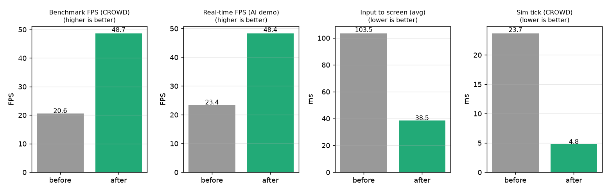

| | Before | After |
|---|---|---|
| Benchmark FPS (CROWD) | 20.6 | 48.7 |
| Real-time FPS | 23 | 48 |
| Press-to-screen latency (avg) | 104 ms | 39 ms |
| Sim tick (CROWD) | 23.7 ms | 4.8 ms |
| Stick noise at rest (p-p counts) | 32-35 | 7-16 |

What mattered, in order:
1. **Run from RAM, not XIP flash.** Both cores were fighting over the 16 KB XIP cache and the flash ran at only 50 MHz. The sim tick went 23.7 -> 13.9 ms and the raster 18.9 -> 9.3 ms at the same 150 MHz. The three libraries in RAM (`GAME_RAM_CODE=sim+render+gfx`) are as fast as the whole image (`GAME_COPY_TO_RAM`); round 1 shipped the whole image, round 2 uses the libraries because the world textures need the RAM.
2. **Overclock to 400 MHz at 1.30 V** (the SDK's limit without the voltage-limit override). 420, 450, 480 and 500 MHz all hung and the watchdog fallback brought the board back at 150 MHz each time (that is the guard working, not luck); 350 is not reachable with the 12 MHz crystal PLL. A 12 minute paced run at 400 MHz had no reset and no fallback (44.9-48.6 FPS, worst frame latency 37 ms; `docs/perf/raw/soak_400_12min.log`).
3. **SPI rate.** Once the CPU is fast the display link is the only limit (the CPU needs about 7 ms per frame, the SPI 20 ms). This panel is clean at 66.7 MHz and below and garbled at 75, 80, 90 and 100 MHz (looked at on the LCD with the SPI test pattern); 66.7 MHz needs a 400 MHz core (divider 6) or a 264 MHz core (66 MHz, divider 4, about 8% slower). Benchmark FPS is exactly 1 / (full-screen transfer time).
4. **Two cores.** Sim on core1 gives 49 vs 42 FPS single core (benchmark 49 vs 40-43).
5. **Late launch** of the sim batch: 41.6 -> 28.3 ms pipeline latency for about 1 FPS.
6. **60 Hz ticks**: real-time FPS follows the tick rate, so 30 Hz ticks cap the game at 30 FPS however fast the pipeline is.

What did **not** matter (measured, left at the defaults): `-O2` for the sim (tick 4.8 -> 5.4 ms, slower), fixed-point ShapoGFX (same), 20 or 30 row bands instead of 40 (slower, more commands), skipping LCD bands identical to the previous frame (`GAME_SKIP_STATIC`, 0.0-0.1 of 6 bands skipped per frame: the camera and the sphere move, every band changes), 16x joystick oversampling (noise only slightly lower than 4x for 85 us per sample).

Rejected for hardware reasons: SPI above 66.7 MHz (garbled picture), core clocks above 400 MHz (hang), core voltage above 1.30 V (not tried: outside the SDK's default limit).

### 1. Where the code runs (stock 150 MHz)

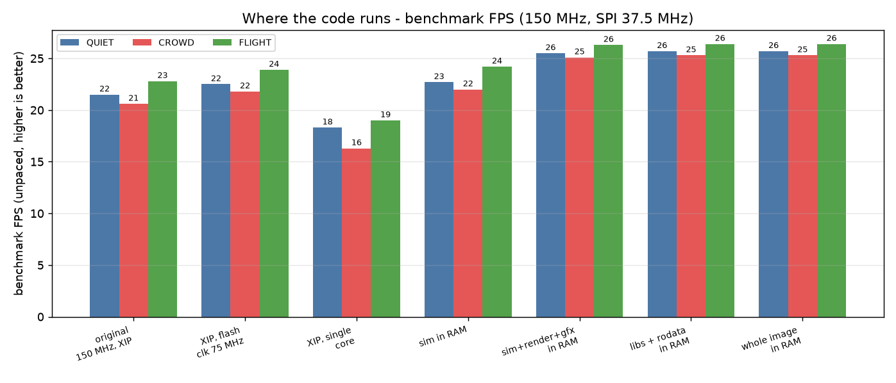
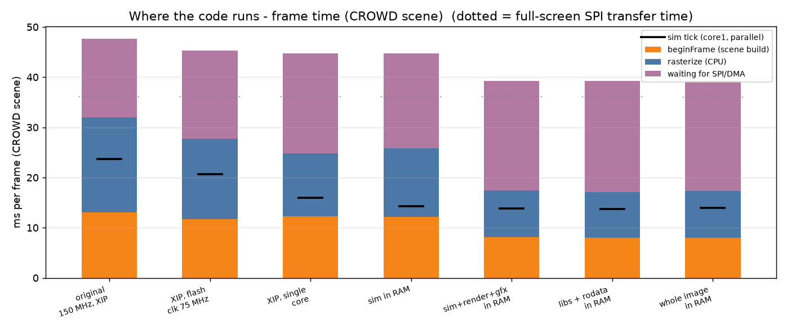

### 2. System clock

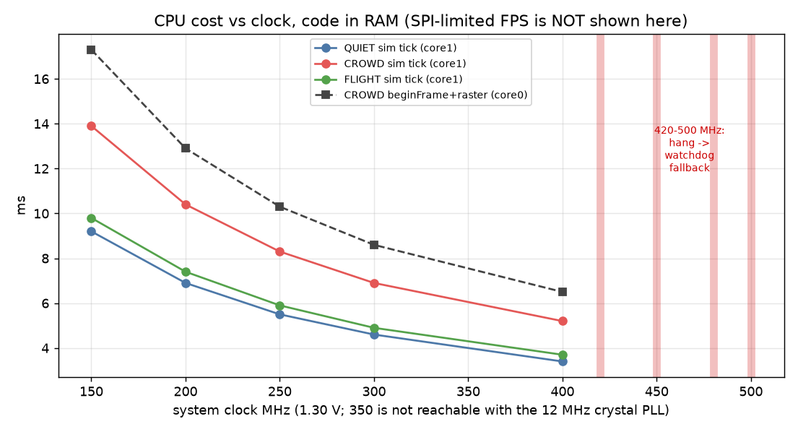

The FPS in the table moves with the SPI divider (40 MHz requested, 31-40 MHz obtained), which is why 250 MHz looks slower than 150: the CPU numbers (chart above) fall monotonically.

### 3. LCD SPI rate

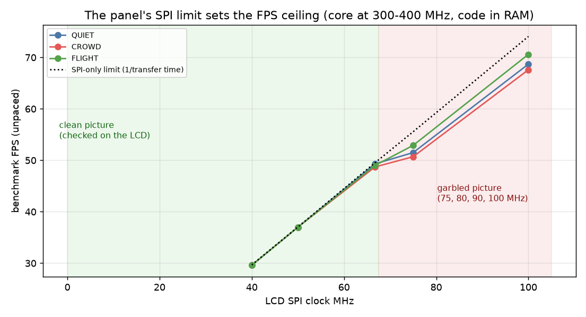

### 4. Final configuration against variants

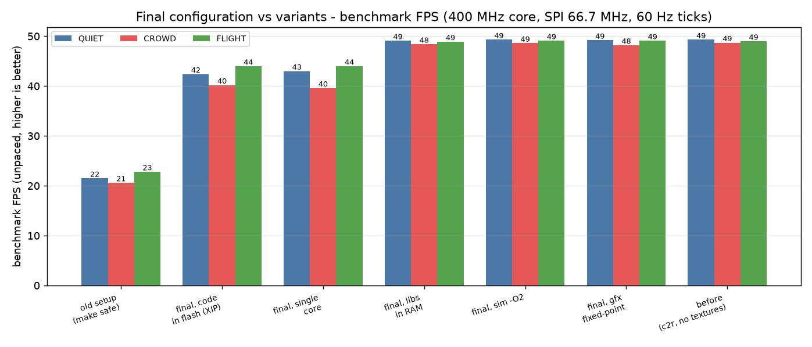
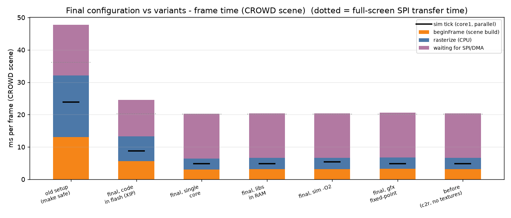

### 5. Input latency and real-time FPS

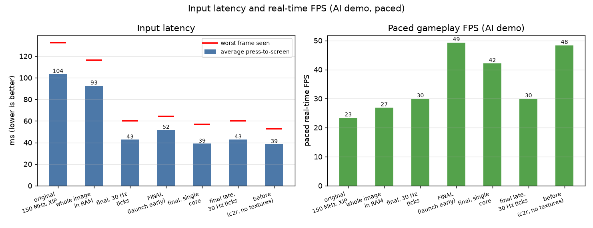

The 30 Hz rows have a lower pipeline latency (the batch is only started when a tick is due) but a longer sampling interval (33 ms), so the average press-to-screen time is about 43 ms against 39 ms for the final 60 Hz configuration, and the worst case is longer.

### 6. Joystick

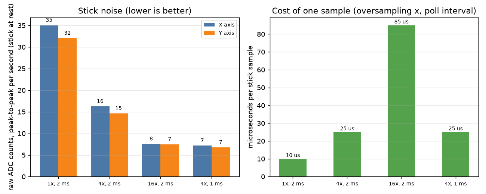

The noise numbers vary by a factor of about 2 from run to run (they depend on the stick resting position and the supply), so read them as ranges: 1x 32-65, 4x 7-16, 16x 7-8 counts. `joystick_read(true)` forces a fresh sample right before every sim batch, and the stick is also read at most every 1 ms otherwise. One sample costs 10 us at 1x, 25 us at 4x, 85 us at 16x.

### Tables

Stage 3 rows with SPI 75 and 100 MHz were run with 30 Hz ticks (real-time FPS 30) and their picture is garbled; they only show the SPI-limited ceiling.

**Stage 1 - where the code runs (150 MHz, 30 Hz ticks, SPI 37.5 MHz)**

| Configuration | Benchmark FPS (QUIET/CROWD/FLIGHT) | Sim tick ms | beginFrame ms | Raster ms | Full-screen SPI ms | Real-time FPS | Press-to-screen ms |
|---|---|---|---|---|---|---|---|
| original (XIP, flash clk 50 MHz) | 22/21/23 | 23.7 | 13.1 | 18.9 | 36.1 | 23 | 104 |
| XIP, flash clk 75 MHz | 22/22/24 | 20.7 | 11.7 | 16.0 | 36.1 | 24 | 101 |
| XIP, single core | 18/16/19 | 16.0 | 12.3 | 12.5 | 36.1 | 17 | 93 |
| sim library in RAM | 23/22/24 | 14.3 | 12.2 | 13.6 | 36.1 | 24 | 100 |
| sim+render+gfx in RAM | 26/25/26 | 13.8 | 8.1 | 9.3 | 36.1 | 27 | 93 |
| libs + rodata in RAM | 26/25/26 | 13.7 | 8.0 | 9.1 | 36.1 | 27 | 93 |
| whole image in RAM (copy_to_ram) | 26/25/26 | 13.9 | 8.0 | 9.3 | 36.0 | 27 | 93 |

**Stage 2 - system clock (code in RAM, SPI request 40 MHz, so the SPI actually moves with the divider)**

| Configuration | Benchmark FPS (QUIET/CROWD/FLIGHT) | Sim tick ms | beginFrame ms | Raster ms | Full-screen SPI ms | Real-time FPS | Press-to-screen ms |
|---|---|---|---|---|---|---|---|
| 150 MHz (SPI 37.5) | 26/25/26 | 13.9 | 8.0 | 9.3 | 36.0 | 27 | 93 |
| 200 MHz (SPI 33.3) | 25/24/25 | 10.4 | 6.0 | 6.9 | 40.5 | 25 | 103 |
| 250 MHz (SPI 31.25) | 23/23/23 | 8.3 | 4.8 | 5.5 | 43.1 | 23 | 111 |
| 300 MHz (SPI 37.5) | 28/28/28 | 6.9 | 4.0 | 4.6 | 36.0 | 28 | 93 |
| 400 MHz (SPI 40) | 30/30/30 | 5.2 | 3.0 | 3.5 | 33.7 | 30 | 88 |

**Stage 3 - SPI rate (the clean/garbled column is from looking at the LCD)**

| Configuration | Benchmark FPS (QUIET/CROWD/FLIGHT) | Sim tick ms | beginFrame ms | Raster ms | Full-screen SPI ms | Real-time FPS | Press-to-screen ms |
|---|---|---|---|---|---|---|---|
| 400 MHz, SPI 40 - clean | 30/30/30 | 5.2 | 3.0 | 3.5 | 33.7 | 30 | 88 |
| 400 MHz, SPI 50 - clean | 37/37/37 | 5.2 | 3.0 | 3.5 | 27.0 | 30 | 49 |
| 264 MHz, SPI 66 - clean | 45/44/47 | 7.3 | 4.7 | 5.3 | 20.5 | 47 | 53 |
| 400 MHz, SPI 66.7 - clean (final) | 49/49/49 | 4.8 | 3.1 | 3.5 | 20.2 | 48 | 39 |
| 300 MHz, SPI 75 - garbled | 52/51/53 | 6.9 | 4.0 | 4.6 | 18.0 | 30 | 42 |
| 400 MHz, SPI 100 - garbled | 69/68/71 | 5.2 | 3.0 | 3.5 | 13.5 | 30 | 36 |

**Stage 4 - final configuration against variants (400 MHz core, SPI 66.7, 60 Hz ticks)**

| Configuration | Benchmark FPS (QUIET/CROWD/FLIGHT) | Sim tick ms | beginFrame ms | Raster ms | Full-screen SPI ms | Real-time FPS | Press-to-screen ms |
|---|---|---|---|---|---|---|---|
| old setup (`make safe`) | 22/21/23 | 23.9 | 13.1 | 19.0 | 36.1 | 23 | 104 |
| code in flash (XIP) | 42/40/44 | 8.8 | 5.6 | 7.7 | 20.3 | 45 | 55 |
| single core | 43/40/44 | 4.8 | 3.0 | 3.4 | 20.2 | 42 | 39 |
| libs in RAM, rest XIP | 49/48/49 | 4.8 | 3.1 | 3.5 | 20.2 | 49 | 52 |
| sim at -O2 | 49/49/49 | 5.4 | 3.1 | 3.5 | 20.2 | 49 | 52 |
| gfx fixed-point | 49/48/49 | 4.8 | 3.3 | 3.5 | 20.2 | 49 | 52 |
| 30 Hz ticks | 49/48/49 | 5.2 | 3.0 | 3.5 | 20.2 | 30 | 43 |
| launch batch early (no late launch) | 49/49/49 | 4.8 | 3.1 | 3.5 | 20.2 | 49 | 52 |
| **FINAL** (late launch) | 49/49/49 | 4.8 | 3.1 | 3.5 | 20.2 | 48 | 39 |

**Joystick (stick at rest, peak-to-peak raw ADC counts per second)**

| Oversampling / poll | X p-p | Y p-p | us per sample |
|---|---|---|---|
| 1x, 2 ms (old) | 35 | 32 | 10 |
| 4x, 2 ms | 16 | 15 | 25 |
| 16x, 2 ms | 8 | 7 | 85 |
| 4x, 1 ms (final) | 7 | 7 | 25 |


### How the safety net works

`clock_guard_begin()` (`src/board/clock.cpp`) arms a 3 s watchdog before the clock is changed; the game loop feeds it once per completed frame. If a configuration hangs during the first 5 s of frames the Pico resets, sees "watchdog reset while unproven" and boots at the stock 150 MHz with a 40 MHz SPI (`fallback 1` in the `CFG` log line), so a bad overclock never needs the BOOTSEL button. A hang later than 5 s resets and retries the same clock. After a ROM reboot (`make flash`, picotool) within 5 s of a boot the same flags look like a hang, so a re-flash that quickly after a boot can fall back once; reboot again.

Flash hazards found on the way: the boot ROM's flash routines reset the QSPI divider to a value sized for 150 MHz, so after a high-score save at 400 MHz the flash would be clocked at 133 MHz (the read-back verify failed). `high_score.cpp` now restores the divider after programming, and `clock_init()` keeps the flash clock at or below 100 MHz at any core clock.

### Reproducing

```bash
make bench                         # flash the self-running benchmark build, read the log (BENCH| lines, 100 s)
tools/perf_run.py my_test SYS_CLOCK_KHZ=264000 LCD_SPI_HZ=66000000   # one named configuration -> docs/perf
make spitest                       # on-screen SPI-rate test pattern (look at the LCD)
PYTHONPATH=<dir with matplotlib> tools/perf_plot.py   # charts from docs/perf/results.json
```

### Button diagnostics

The once-per-second log line carries `st <game state> pz <paused> btn <hex mask>`: bit 0 UP, 1 LEFT, 2 RIGHT, 3 DOWN (stick), 4 X, 5 Y, 6 A, 7 B (so `btn 080` = B held down). `GAME_INPUT_TEST=ON` runs a scripted title -> start -> pause -> resume -> pause -> restart -> start sequence and prints `TEST step N ...` lines; it passed on the board at the final settings.

### What is actually wired (found with the `BTN` log)

Only two buttons exist on the console, on **GP8 (firmware "X", sim A: choose / shoot)** and **GP9 (firmware "Y", sim PAUSE)**. GP10 ("A") is not connected (floats high, never pressed). GP11 ("B") reads as pressed all the time (`btn 080` in the log line); the user confirmed it is not a button they use. The sim therefore sees `Button::B` held permanently, exactly as before the optimisation work; this is harmless in the game but it is what made the in-game benchmark (hold B for 3 s on the title) start by itself once it had been wired in, which is why it is now compiled out unless `GAME_BENCH_ENABLE=ON`. The log prints `BTN <old> -> <new>` on every change of the button mask.


## Round 2: music and world textures

Goals: (1) the music was too fast from the first bar and unpleasant; (2) the worlds were bare wireframes on black. Same log-only method as above (`tools/perf_run.py`, the game's own benchmark). Before = the state at the end of the first optimisation round, after = this round.

### Music

What was wrong: tier 0 ran at 136 BPM with a 9 notes/s 16th-note arpeggio, tier 3 at 214 BPM with 14 notes/s, the melody reached 1175 Hz (shrill on the small speaker), and a loop was 8 bars of nothing but arpeggio then 8 bars of melody.

What it is now (`src/audio/sound.cpp`; same single PWM voice and 1 kHz sequencer, so no CPU cost):
- **An original piece in the spirit of big, slow sci-fi scores** (you asked for something Interstellar-like and "epic"): a rolling arpeggio that breathes under long, swelling melody notes, in A minor (Am F C G | Am F Dm E). It is *not* the Interstellar theme, which is copyrighted music and is not reproduced; the style (slow organ-like arpeggio, long swelling notes, build-up) is what is borrowed.
- **Tempo**: 75 BPM on the calm tier, 83, 94 and 107 BPM on the three louder tiers (it was 136 to 214). 8th-note arpeggio (2.5 to 3.6 notes/s). One knob, `MUSIC_TEMPO_PCT` (default 100): `make flash CMAKE_ARGS="-DMUSIC_TEMPO_PCT=85"`... (compile-time).
- **Register**: the melody now sits at 196 to 587 Hz (before: up to 1175 Hz); "the high tones are too much" was the feedback that decided this.
- **Loop shape**: 4 bars of arpeggio, 8 bars of melody, 4 bars of arpeggio. The outro chords (Am F Dm E) lead back into the melody, the intro chords (Am F C G) lead into it.
- **Dynamics**: long melody notes (a beat and a half or more) swell in over the first quarter, hold, and release; they carry a slow vibrato (5 Hz, about 20 cents) after 250 ms. Short notes get a soft attack (no click) and a gentle decay.
- The four tiers are the same theme with growing motion, register and tempo; the existing growth score still moves you up the tiers as the sphere grows.

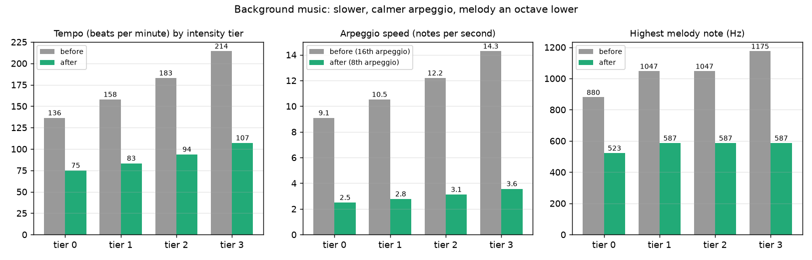

`tools/music_render.py` renders the tiers to WAV files (`docs/music/music_tier*.wav`, 24 s each) from the tables in `sound.cpp` so changes can be listened to on a PC before flashing; the real speaker is a PWM square wave and will sound rougher, but tempo, notes and structure are identical. The previous version of the file is kept as `docs/music/sound_before_rework.cpp.txt` for the before/after chart.

### World textures

The game draws a world only as wire lines, so there was nothing to put a texture on. What was built:
- **A patched copy of the game core** (`third_party/devoursphere_core/`, `PATCHES.md` lists every change; the original in /opt is untouched). Three small patches: a hook that runs right after a band is cleared (the bottom layer), the integer backdrop camera exported as floats, and an alpha for the wire lines (0 = not drawn).
- **`src/world/planet_core.cpp`** (platform independent, also built on the PC by `tools/planet_preview.cpp` to look at it before flashing): for each 2x2 pixel block it casts a ray from the camera at the world sphere (numerically stable ray-sphere test), samples a per-world height field (a 6 x 64 x 64 cube map with bilinear filtering, generated from the sphere's seed with 5 octaves of 3D value noise), adds two tiling layers for the ground near the player (28 FU "hills" that also give slope shading, and 5 FU "grain"), turns the height into a colour through a per-world palette, lights it with a sun direction (also per world) and fades it with distance. Five palettes: terra (land, lakes, rock, snow), mars, ice, lava (glowing valleys), alien. Blocks farther than 30 FU are shaded once for 4x2 pixels because their fine layers have faded out; where two cube faces meet the hills of both are cross-faded so there is no crease.
- **No wire grid** (your request): the grid is not drawn any more, the surface is. (`PLANET_WIRE_ALPHA` 0..256 brings it back translucent or solid; the segments are still built, so the mesh budget and the benchmark's `LIN` row are unchanged.)
- **Worlds are built in the background.** A new world takes about 90 ms of CPU. Built in the foreground that was a 106 ms frame every time a sphere changed. Now core1 builds it in slices of at most a few ms between sim batches (38 steps) while the old surface stays on screen, and it is swapped in about 108 ms later. This needs a second set of maps: the renderer's scratch arena was cut from 96 KB to 64 KB for it (the benchmark never uses more than 13 KB: `ARNK`), and the palette table is shared and rebuilt at the swap (about 1 ms). Free RAM is about 12 KB in the benchmark build and about 24 KB in the game build (the benchmark build carries extra buffers).
- `GAME_PLANET_TEX=OFF` gives the old look back (and the old frame time).

How the surface looks (renders of exactly this shader on the PC, with real camera positions logged from the board; the LCD itself is not photographed):

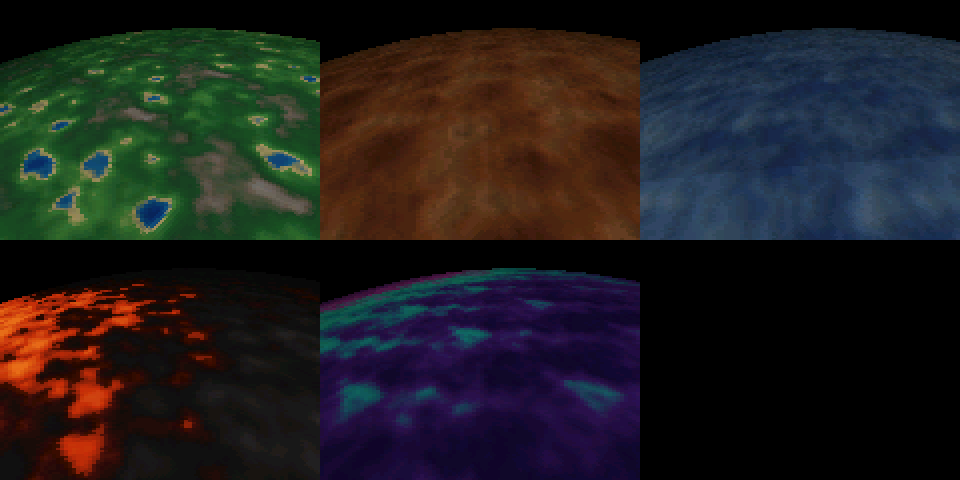

#### Benchmarks, before and after

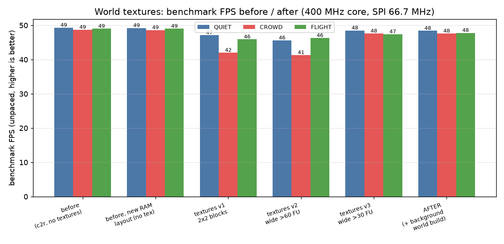
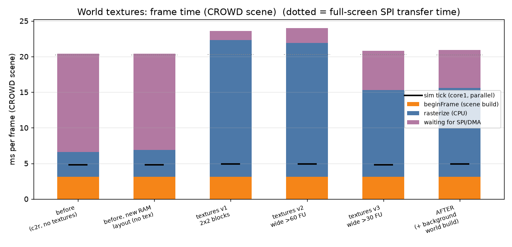

### Round 2: textures, before and after

| Configuration | FPS QUIET/CROWD/FLIGHT | Real-time FPS | Press-to-screen ms | beginFrame ms | Raster ms (incl. planet) | Planet pass ms | Blocks/frame | Longest frame FLIGHT ms |
|---|---|---|---|---|---|---|---|---|
| before: whole image in RAM, no textures | 49.3/48.7/49.0 | 48 | 39 | 3.1 | 3.5 | - | - | 26 |
| before: libraries in RAM, no textures | 49.2/48.6/49.0 | 48 | 39 | 3.1 | 3.8 | - | - | 26 |
| textures v1: 2x2 blocks everywhere | 47.1/42.0/45.9 | 45 | 42 | 3.1 | 19.2 | 13.4 | 13184 | 106 |
| textures v2: 4x2 beyond 60 FU | 45.6/41.3/46.3 | 46 | 41 | 3.1 | 18.8 | 12.7 | 11139 | 106 |
| textures v3: 4x2 beyond 30 FU, world built in the foreground | 48.5/47.6/47.4 | 48 | 39 | 3.1 | 12.2 | 8.2 | 6885 | 106 |
| **after: v3 + world built in the background** | 48.4/47.6/47.8 | 48 | 39 | 3.1 | 12.5 | 8.5 | 6835 | 26 |

**What the benchmark counts per scene (QUIET / CROWD / FLIGHT), identical with and without textures**

| Counter | Meaning | QUIET | CROWD | FLIGHT |
|---|---|---|---|---|
| TRI | triangles drawn (peak per frame) | 58 | 145 | 30 |
| TRIK | triangle memory, KB | 3 | 9 | 2 |
| SPN | spans in the span buffer (peak) | 18 | 26 | 12 |
| ARNK | scratch arena in use, KB | 8 | 13 | 6 |
| LIN | sphere wire segments built per frame | 515 | 546 | 775 |
| DRP | primitives dropped for lack of memory | 0 | 0 | 0 |


Triangles, spans and the other renderer counters are untouched by the textures (the surface is painted per pixel, not as triangles), the benchmark never drops a primitive, and the scratch arena in use peaks at 13 KB of the 64 KB now provided:

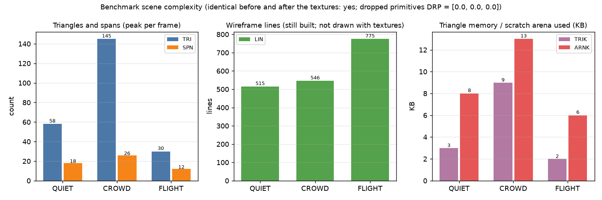

What the texture pass itself costs and what the three steps bought:

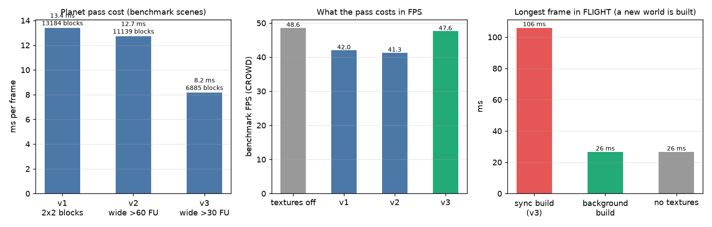

Reading it: the first version (2x2 blocks everywhere) cost 13.4 ms of CPU per frame and took the CROWD scene from 48.6 to 42.0 FPS; widening distant blocks to 4x2 brought it to 8.2 ms and 47.6 FPS, i.e. the textures cost about 1 FPS (2 %) and 8 ms of core0 time per frame (hidden behind the SPI transfer except for the first band). Real-time FPS (48) and press-to-screen latency (39 ms) are unchanged. The cost per painted block is about 1.2 us (about 480 cycles at 400 MHz: the ray test, the cube-map lookup, the detail layers and the palette lookup); the detail layers are about 100 of those cycles, bilinear filtering about 28.

A methodology note: one intermediate run (`m2_tex_on3`) was discarded because the build cache still had two experiment switches (`PLANET_NO_DETAIL+PLANET_NEAREST`) from the cost bisection, which made it measure a cheaper shader. `tools/perf_run.py` now pins `PLANET_DEFS` so this cannot happen again; the runs shown above use the full shader.

### Shader tuning knobs (`src/world/planet_core.cpp`, `-D` or `GAME_PLANET_DEFS`)

`PLANET_BLOCK_W/H` (2x2 pixels per ray), `PLANET_WIDE_FU` (30: beyond this the block is 4 wide), `PLANET_FOG_NEAR_FU/FAR_FU`, `PLANET_HILL_TILE_FU/FADE_FU`, `PLANET_GRAIN_TILE_FU/FADE_FU`; brightness is the `shade` line in `render()`.

## Round 3: textured player body, HUD legend

**Player skin (plan).** The player's body is a cluster of small flat "kite" quads (the fragments, drawn as wings) plus a white core, all one flat colour, so it did not match the textured world. The fork gets a skin hook: `Renderer::setSkinHook()`, called by `drawEntity()` for every vertex of every fragment kite of the entities the hook accepts (only the player). `src/world/planet_core.cpp::skin()` answers with a colour taken from the *current world's* palette and tiling terrain layers at the vertex's position on the body, so the creature carries the same land/lava/ice/alien patterns as the ground it flies over. Colours are per vertex (vertex-colour material), so the pattern is smooth across each kite. The white core, the red hit flash and the far-away outline are unchanged, enemies keep their size-coded colours (red/blue/gold identify threats, so they are not recoloured).

**The symbols at the bottom of the screen** (from `hud.cpp` / `config.hpp`):

| Where | Symbol | Meaning |
|---|---|---|
| bottom left | cyan tall diamond + 3 bars | **Shield**: damage taken 75 % / 50 % / 50 % at level 1 / 2 / 3; level 3 also regenerates 5 % per second |
| bottom left | orange triangle + 3 bars | **Overdrive**: fire rate x1.25 / x1.5 / x2 at level 1 / 2 / 3 |
| bottom left | green arrowhead (chevron) + 3 bars | **Thruster**: dash speed x1.25 / x1.5 / x2 at level 1 / 2 / 3 |
| bottom right | pink four-pointed stars (up to 3) | **Spare cores** (extra lives); bright = you have it, dim = empty slot; you start with 1 |
| bottom centre | small text | the game core's version (v3.8) |

The bars under each upgrade icon are its level (maximum 3): a filled bar is a level you have, an outline is a level still to find, and an icon that is dim has level 0. Upgrades are collected by flying into the spinning pickups of the same colour and shape (some enemies carry one and are outlined in white); the pink star pickup (a spare core) appears in about one sphere in three.

### Round 3 result: the textured player

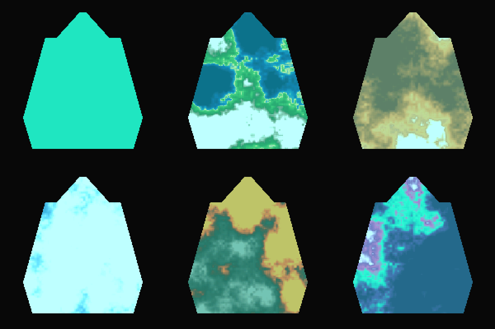

Top left: the old flat teal body; then terra, mars, ice, lava and alien skins (renders of `planet::skin()` on a winged silhouette; the hook mixes 62 % of the world colour with the player's own teal, `PLANET_SKIN_MIX`, and brightens it a little, so the player stays recognisable against ground of the same palette). The pattern scale is `PLANET_SKIN_TEXELS`, the brightness `PLANET_SKIN_SHADE`. The white core, the red hit flash, the far-away outline and every enemy are unchanged.

Measured with the same benchmark (QUIET/CROWD/FLIGHT):

| Configuration | Benchmark FPS | Real-time FPS | beginFrame ms (CROWD) | TRI | TRIK KB | ARNK KB | DRP | Longest frame ms |
|---|---|---|---|---|---|---|---|---|
| before (flat player body) | 48.4/47.6/47.8 | 48 | 3.1 | 58/145/30 | 3/9/2 | 8/13/6 | 0/0/0 | 21.5/22.1/26.5 |
| **after (textured player body)** | 48.3/47.4/47.7 | 48 | 3.2 | 58/145/30 | 4/9/2 | 8/14/6 | 0/0/0 | 21.5/22.2/26.5 |

The skin costs nothing you can measure: the same FPS, 0.1 ms more in `beginFrame` (sampling the terrain tile at 8 vertices per fragment), the same number of triangles, about 1 KB more triangle memory (vertex-coloured kites take a larger record than flat ones), nothing dropped.

## Round 4: choose your world, a cut scene that fills the last RAM

**Bottom symbols at the start.** The sim starts every upgrade at level 0 and with one spare core (`resetUpgrades()`: levels 0, `CORES_START` = 1). So at the start of a game you see three *empty* bar outlines under dim icons (three is the maximum level, not the starting level) and one bright star with two dim ones. The log line now prints `up <shield><overdrive><thruster> core <n>` so this can be checked on the board.

**World select (plan).** Pressing A on the title opens a platform-level screen before the game's own weapon select: a slowly orbiting textured globe of the chosen world (the same ray-cast shader as the ground), its name and a one-line description, left / right on the stick to change, A to confirm, Y to go back. The chosen world is the *look* of the first sphere (palette, terrain, sun); later spheres continue through the other four in order, so a run still travels through different worlds. It does not change the difficulty. A hook added to the fork (`setScreenHook`, called right after a band is cleared, may paint the whole band and skip the scene) lets these screens be drawn by our own code; the simulation is paused while a screen is up.

**Cut scene (plan).** When a game starts (the first ARRIVE after the weapon select) a 5 s cut scene plays before the arrival flight: warp-speed star streaks tinted with the world's colour, drop out of warp, the chosen world swelling from a dot into a textured globe, a dive toward the surface, cinematic letter-box bars, typed-out title text, a fade-in into the game. A is skip. Its star field is the only thing that needs memory, and it takes exactly what is left: at the start of the scene it asks the heap how many bytes are free (about 11 KB), keeps a fixed reserve for the C library and the stack, and turns the rest into stars (8 bytes each); the star count, bytes used and the per-frame cost are printed on the log, so the fit is measured, not assumed.

### Round 4 result

**World select** (press A on the title): a slowly orbiting textured globe of the highlighted world, its name in the world's colour, a one-line description, one dot per world; stick left / right changes the world (the globe is rebuilt in the background in about 0.1 s), A confirms and continues to the game's own weapon select, Y goes back. The chosen world is the *look* of the first sphere (palette, terrain, sun); each later sphere uses the next world in order (TERRA, MARS, GLACIER, INFERNO, XENOS, then around), so a run still travels through all five. It does not change difficulty or the score. Starting on a higher sphere level was deliberately not offered: it would make high scores incomparable.


**Cut scene** (first arrival of a new game, 5.2 s, A skips after 0.6 s): letter-box bars slide in; warp streaks accelerate (tinted with the world's colour); the jump ends with a drop-out sound as the streaks shrink; the world appears as a dot and swells into a textured globe while its name types in; a dive toward the surface with the bars opening; the game fades in from black over 0.45 s into the sim's own arrival flight. The simulation is paused for the whole scene, and the music starts when it ends.

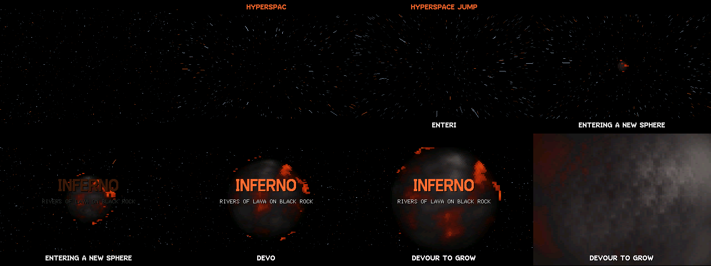

(Frames at 0.3, 0.8, 1.4, 2.2, 3.0, 3.7, 4.3 and 4.9 s of the INFERNO scene, rendered on the PC by `tools/intro_preview.cpp` with the real `intro.cpp` and the real graphics library; the star count differs from the board's.)

**How it fits the last bytes of RAM.** The only memory the cut scene needs is its star field, so `allocStars()` (`src/ui/intro.cpp`) asks the C library how much heap is free *at that moment* (`mallinfo()`; the SDK's optimistic `sbrk` hands the whole heap to malloc on its first call, so `sbrk(0)` cannot be used), keeps `INTRO_RESERVE_BYTES` = 2048 B for stdio and growth, subtracts malloc's 64 B of bookkeeping and turns the rest into 8-byte stars. On the board that is **2736 stars = 21,888 B out of 24,000 B free**, and the memory goes back to the heap when the screen closes (so nothing is permanently lost to the game). Each star is one 8-byte struct (x, y, z, brightness, tint); positions are advanced once per frame, and the projection is redone per band so no per-star screen position needs storing. The log prints `INTRO stars N = B bytes of F free (reserve R)` every time it is allocated.

**Cost.** Painting the select screen takes 8.6 ms of CPU per frame, the cut scene 5.0 / 6.5 / 7.6 / 8.8 / 12.5 ms in its five seconds (the dive is the expensive part: the world fills the screen, so it is painted in 4x2 blocks); the frame period stays 20.25 ms (49.3 FPS, SPI-bound) throughout, so there is no frame drop anywhere in it.

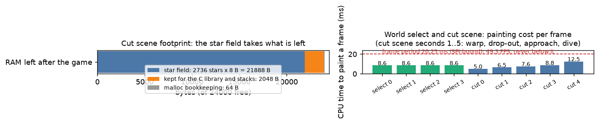

Other things that changed: the simulation can be frozen (`g_freeze`) while a platform screen is up, the renderer got `setScreenHook()` (a screen may paint whole bands and skip the scene), the planet shader takes a style (`planet_request_world(seed, style)`) and a runtime "wide block" threshold, and the log line gained `ui <0 none, 1 world select, 2 cut scene>` and `up <shield><overdrive><thruster> core <n>` (the HUD question: at the start of a game it reads `up 000 core 1`).

Verified on the board by the scripted input test (`GAME_INPUT_TEST=ON`: title, world select opens, two to the right, confirm, weapon select, cut scene runs and ends, pause, resume, pause, restart, world select opens again): all steps pass. Verified by the user on the LCD: world select works and looks right, the cut scene is as intended.

## Round 5: controls text, deaths, per-weapon high scores, upgrades that matter

Reported: (1) the title shows the PC key hints ("arrows move, space fire"); (2) you always die exactly twice; (3) on death the screen goes blank and it is not shown whether the high score was stored; (4) the high score should be shown on the missile / laser / vulcan screen; (5) the three upgrades and the spare cores change gameplay too little.

Method: first reproduce the death on the board with the scripted input test (an idle player is eaten) and read the log (state, cores, upgrades, reboot / watchdog lines), then fix what the log shows. Plan:
- **Controls text**: `ControlHints` with the real controls of this console (stick = move, UP = dash, DOWN = brake, A = fire, Y = pause) instead of the PC defaults.
- **Deaths**: the rules are `CORES_START` = 1 spare core, so the first death costs the core and a level of every upgrade and the second ends the run. That is by design; the plan is to make the number of lives depend on how you play (see below) rather than be fixed at two.
- **High score placement (user request)**: not on the title screen any more; on the weapon select screen each of the three weapons shows its own best score under its description (drawn by the fork's HUD, so it follows the layout). The game-over screen keeps showing the score and the best of the weapon used.
- **High scores per weapon**: one record per weapon in the flash sector (three 16-byte records), the best score of the highlighted weapon shown on the weapon select, and a clear "NEW HIGH SCORE - SAVED" / "HIGH SCORE nnn" message on the game-over screen, driven by whether the flash write really verified.
- **Upgrades and lives that matter**: to be designed after reading the sim's damage, score and respawn code; every change is measured on the board.

### Round 5 result

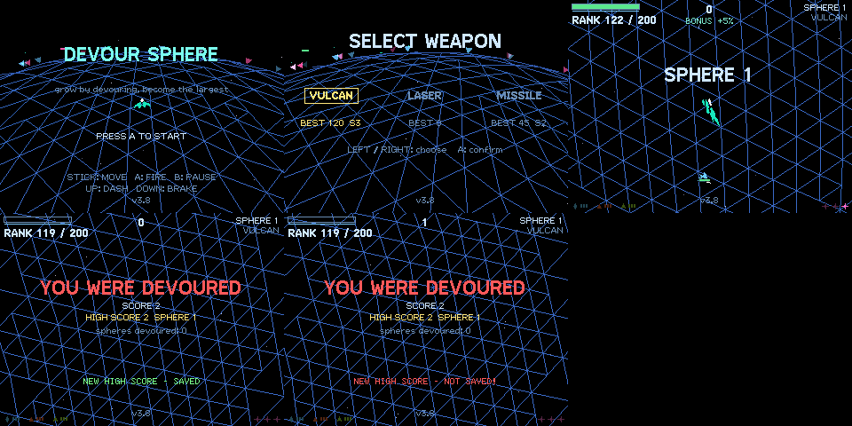

(PC renders of the game's real renderer: title, weapon select, playing, game over with the high score stored, game over when the flash write fails. `tools/hud_preview.cpp` builds the whole core on the PC.)

**1. The blank screen on death was a crash, and it is fixed.** Reproduced with the scripted test (`GAME_INPUT_TEST=ON` now plays on autopilot for 80 s and then kills the player twice through the normal kill path): after the second death the log stopped dead (no frame lines, watchdog reboot). Cause: the game over is the first time the firmware writes the high score to flash, and the write routine (`write_job`) lived in flash. The boot ROM's flash calls reset the QSPI divider to a value that is too fast for a 400 MHz core, so the first instruction fetched from flash after the erase faulted. It was never seen in round 1 because the whole image ran from RAM then. `write_job` now runs from RAM (`__not_in_flash_func`) and restores the divider before returning. After the fix: `HS save: 6 / 0 / 0 ok`, game over reached, 47 FPS afterwards, no reboot, and the score is read back after a reboot (`hs 6/0/0` in the log).

**2. Control hints.** The title still showed the PC defaults because round 3 only replaced the pause text. Now: `STICK: MOVE   A: FIRE   B: PAUSE` / `UP: DASH   DOWN: BRAKE`, and the pause screen and the world select say `B` too (your two buttons are called A and B; the firmware calls them X and Y). There is no dodge: that is the third button, which this console does not have.

**3. High scores.** Not on the title any more. One best score per weapon (vulcan, laser, missile), kept as three records in the flash sector; on the weapon select screen every weapon shows `BEST n  Sk` (the score and the sphere reached) under it. The game over screen shows the game's own `SCORE` and `HIGH SCORE` lines for the weapon you used, and below them whether it was stored: green `NEW HIGH SCORE - SAVED` (only after the flash read-back matched), red `NEW HIGH SCORE - NOT SAVED!` otherwise. An old single-record sector loads as the vulcan's score.

**4. Why you died exactly twice, and what changed.** The rule was one spare core at the start (`CORES_START` = 1): the first death uses it, the second ends the run, and cores were only found as rare pickups. Upgrades start at level 0 and are worth finding (the carriers are outlined in white) but did little. New rules (fork, constants in `config.hpp`, `PATCHES.md` item 8):

| | Before | After |
|---|---|---|
| Spare cores | 1 at the start, rare pickups | 1 at the start, **+1 for every 10 points and +1 for every sphere devoured**, up to 3 |
| Shield damage taken | 75 / 50 / 50 % | 70 / 50 / 35 % |
| Overdrive fire rate | x1.25 / 1.5 / 2 | x1.4 / 1.9 / 2.6 |
| Thruster dash speed | x1.25 / 1.5 / 2 | x1.4 / 1.9 / 2.6 |
| After losing a core | 75 % of your size, 2 s invincible | 85 % of your size, 4 s invincible |

So the bottom symbols now decide how hard you are to kill and how fast you shoot and dash, and the number of lives depends on how well you play instead of being fixed at two. (A score bonus from upgrades and cores was part of this round and was removed at the user's request: no multiplier, no `BONUS` text.)

## Round 6: real music tracks (Pixabay) instead of the synthesized tune

**What was asked**: use tracks from https://pixabay.com/music/search/space/ . **What is possible from here**: the site sits behind a bot check (HTTP 403 "Just a moment...") and a track page does not expose an audio URL to a plain fetch, so the files cannot be downloaded by the tooling. They have to be saved by the user with the site's "Free download" button into `music_src/`. Licence: each track page says "Free for use under the Pixabay Content License" (free to use in a project like this one, no attribution required, but it is not public domain and the tracks must not be redistributed on their own); the tracks used are credited in `docs/music/CREDITS.md` anyway.

**Plan**
- **Format**: mono 15.625 kHz, 4-bit IMA ADPCM in 256-byte blocks (about 7.9 KB/s, 7 minutes of music in 3.5 MB), packed by `tools/music_pack.py` from the MP3/WAV files (ffmpeg from a pip wheel does the decoding and resampling, with loudness normalisation and a band limit for the small speaker). The pack goes to its own flash region at 512 KB (`0x10080000`, up to the high-score sector, 3.5 MB) with `picotool`, so flashing the game does not touch it and it is loaded once.
- **Player** (`src/audio/sound.cpp`): the PWM slice becomes a 31.25 kHz, 8-bit DAC fed by an interrupt (`PWM wrap`), which decodes the ADPCM stream and also synthesises the sound effects per sample (same pulse-width tones as before). Effects still cover the music, the music keeps its position underneath. The four intensity tiers of the game choose tracks 1-4 in file-name order; a tier change fades the current track out (0.6 s) and the next one in. No pack in flash: the synthesized tune of round 2 plays as before.
- **Checks on the board**: a decoder self-test (the first second of track 1 is decoded on the Pico and its checksum compared with the packer's), the interrupt's load, frame rate with the player running, and a test with stand-in audio before any real track is needed.

### Round 6 result: your Pixabay tracks play

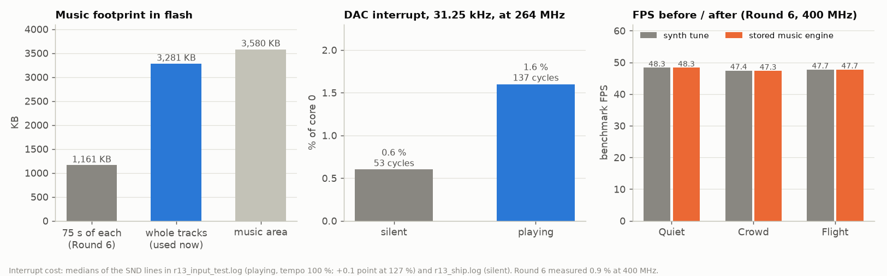

**What is on the board.** Two of the tracks you downloaded into `docs/music/`: "Space" by leberch (2:40) and "Space" by Sub_Clair (4:24). As you said, only a part of each is stored: `tools/music_pack.py --window 75` picks the **most energetic 75 s** (not the intro or the ending; 40 s into leberch, 19 s into Sub_Clair), so the music image is **1,161 KB instead of 3,281 KB** (the flash area allows 3,580 KB, so a third and fourth track or longer windows still fit). Credits: `docs/music/CREDITS.md`.

**How it plays.** Tiers 0-1 of the game's intensity (the music gets more intense as your sphere grows) play leberch, tiers 2-3 play Sub_Clair; a tier change fades the track out over 0.6 s, starts the other and fades it in. The track loops (0.15 s fades at both ends hide the join). Sound effects still cover the music and the music keeps its place underneath. Titles and menus have no music, as before. With no pack in flash, the synthesized tune of round 2 plays.

**Numbers (all from the log).**
- The speaker pin is now a 31.25 kHz, 8-bit PWM DAC driven by an interrupt; the sound effects are generated by the same interrupt (same pulse-width tones as before).
- The interrupt costs **0.9 % of core 0 while music plays** (117 cycles per sample including the ADPCM decoding) and 0.5 % when silent; it keeps exactly 31,249-31,250 samples per second.
- The benchmark is unchanged: 48.3 / 47.3 / 47.7 FPS (before 48.3 / 47.4 / 47.7), real-time 48.2 FPS (the demo plays the music).
- **Decoder proof**: at start-up the board decodes the first second of track 1 and compares a checksum with the one the packer stored; `SND pack yes tracks 2 selftest 1` in the log means the decoder on the board is bit-exact. A pack that fails the test is not used.
- ADPCM quality: 27.6 dB (leberch) and 37.9 dB (Sub_Clair) signal-to-noise after compression.
- Forcing tier 3 in the scripted test makes the log show the switch: `track 0 gain 246` (fading) then `track 1 gain 255`.

**Using it.** Put MP3 or WAV files into `docs/music/` (track order = file name order), then `make music` (packs 75 s of each and loads them to flash; `MUSIC_WINDOW=100` for longer, `MUSIC_FILES=...` to choose files). `make flash` never touches the music, so it is needed only when the tracks change; `make music-clear` removes them. The packer needs ffmpeg (`pip install imageio-ffmpeg` is enough).

**Things to know.**
- The flash is split: the firmware (272 KB now) at the start, the music pack at 512 KB, the high scores in the last sector. The build fails if the firmware ever grows past 512 KB.
- Rebooting twice within 5 s (as `make music` does after a fresh boot, or two quick `picotool reboot`s) can make the clock guard fall back to 150 MHz once; reboot again after 10 s.
- **I cannot hear the board.** The decoder is proven bit-exact and the levels are the packer's loudness normalisation with `MUSIC_SAMPLE_VOLUME` = 70 (`-DMUSIC_SAMPLE_VOLUME=` to change; effects are unaffected); how it sounds on the real speaker (loudness, any hiss from the 8-bit PWM) still needs your ears.

### Round 6 follow-up: the music was too quiet (fixed)

Measured first: with the log's level numbers, the stored music came out at about **8 counts RMS** on the speaker against **100-125 for the sound effects** (about 23 dB quieter). Two causes: the packer normalised to broadcast loudness (-15 LUFS, lots of headroom) and the player used only 70 % of a reduced swing around a low middle level.

Fixed in both places:
- **Packer** (`tools/music_pack.py`): band limit, then a compressor (6:1), +5 dB of drive and a look-ahead limiter at -0.45 dBFS instead of `loudnorm`. It prints the level it produces (about -10 dBFS RMS, peak at the limit, 0 % clipped).
- **Player** (`audio/sound.cpp`): middle level 128 and a swing of up to +-127 (`MUSIC_SAMPLE_VOLUME` 100 = the full swing of the DAC; it was 70 of a smaller range). The sound effects are untouched.
- **Verified on the board**: the log line now ends with `music-rms n/127`, measured in the interrupt on the real output: **40-42 on leberch, 33-36 on Sub_Clair** (was about 8), i.e. about 14 dB louder and 8-10 dB below the effects, which keeps the effects on top of the music. If it is still too quiet or too loud: `MUSIC_SAMPLE_VOLUME` (compile time, 0-100 scales the stored music only) or a different `acompressor` / `volume=` in the packer for more drive (the limiter makes extra drive give little more than 1-2 dB).
- The sections kept are now chosen on the compressed audio, so they moved (leberch from 75 s, Sub_Clair from 179 s into the tracks); `--start N` pins a section.

### Round 6 follow-up: the music speeds up as you level up

User request: "let the music become faster as I level up". The stored tracks are played through a variable-rate stage in the DAC interrupt (a Q16 phase accumulator with linear interpolation between decoded samples), so the speed can change smoothly without any retiming of the audio. Speed = 100 % at sphere 1, **+4 % per sphere, up to 130 %** (`MUSIC_SPEED_PER_LEVEL_PCT`, `MUSIC_SPEED_MAX_PCT`); the change is slewed (about 1.2 s for the full range), never a jump. It is a tape-style speed-up, so the pitch rises with the tempo (+30 % is about 4.5 semitones). The sphere level that drives it is the one shown as `SPHERE n` on the HUD; a new game starts again at 100 %. The log line shows `speed n%`.

Measured on the board (scripted test forcing sphere level 8): `speed 100%` -> `speed 127%` (level 8 = 100 + 4 x 7 = 128 %; the 130 % cap is reached at sphere 9), the music level stays at 36-38/127, the DAC interrupt 31,249-31,250/s, and its cost rises from 0.9 % to 1.1 % of core 0 (the interpolation). Only the stored music follows the level; the synthesized fallback tune keeps its own tempo tiers.

### Time up ends the game

User rule: when a sphere's time runs out the sphere was not devoured, so the game stops; **the score at that moment is the final score**, as it is when the last life is gone. Before, running out of time cost a spare core (and a level of every upgrade) and restarted the same sphere. Now (fork patch 9): the timed-out player breaks apart as before and the game goes **straight to the game over screen, whatever spare cores are left**; nothing is restarted and nothing is deducted. The screen reads `TIME UP` / `THE SPHERE WAS NOT DEVOURED`, then the usual `SCORE`, `HIGH SCORE` and the saved / not saved line; a best score reached before the time ran out is stored like any other.

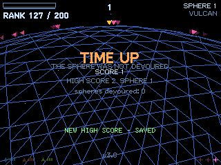

(PC render of the real renderer; the green line in this picture is only the preview harness forcing the message, and the grid is there because the PC build has no planet surface.)

Verified on the board by the scripted test (`debugExpireTime()` makes the time run out in the middle of a game with a spare core in hand): `game over: spare cores left 1, time up 1`, the frame rate stays at 47.7 FPS. The only ways a game ends now: the last life is gone, or the time of a sphere runs out. (Spare cores are still earned per 10 points and per sphere devoured, so they matter for the first of the two.)

## Round 7: sleep mode

User request: a sleep mode that consumes the least power, with the B button waking the console again **from the exact moment it went to sleep**, using the hardware as well as possible.

**Design.** The RP2350's DORMANT state is the deepest one that keeps everything: the crystal oscillator is stopped, so both cores, the PLLs and every peripheral clock stop, while RAM, registers and the program counters stay powered. A GPIO edge restarts the oscillator and both cores continue at the instruction after the sleep call, so the game, the music position and the sim tick resume exactly. (The chip's power-manager states that switch the whole processor domain off draw less but restart the CPUs from the boot ROM, which would need the whole CPU context rebuilt by hand; not worth the risk of a console that does not wake.)

Before sleeping (`src/board/sleep.cpp`): pause a running game (so the wake shows the same frame and "B: RESUME"); finish the display DMA; put the LCD to sleep (`DISPOFF`, `SLPIN`, backlight off: its GRAM keeps the last frame); stop the speaker DAC and drive its transistor low; disable the watchdog; switch the system clock to the 12 MHz crystal, stop the PLLs, the USB / ADC clocks and the ring oscillator; drop the core voltage from 1.30 V to the default 1.10 V (lower than that trips the brown-out detector and resets the chip: tried, it does); arm the GPIO wake on B (GP9) once B has been released, as a *level* ("B is low"): edge detection needs a clock and every clock is stopped while dormant (an edge trigger put the board to sleep but never woke it); enter DORMANT. After the wake: the ring oscillator restarted (the SDK's clock setup steps through it: without it the clocks never come back, found the hard way), voltage back up, `clocks_init()` and the normal 400 MHz sequence, LCD out of sleep (`SLPOUT`, 120 ms, `DISPON`, backlight), DAC and watchdog re-armed, and the wake press is swallowed (no accidental pause toggle) until B is released.

**Triggers.** Hold B for 2 s (anywhere in the game; if it is playing it is paused by the first press), or 3 minutes without any input while paused, on the title, or on the game over screen.

**Limits (honest).** USB serial may need a moment (or a re-plug) after a wake; `make flash` cannot talk to a sleeping board (wake it first). The joystick potentiometers stay powered from 3V3 (about 0.7 mA) and the Pico 2's own regulator idles at a few hundred microamps: cutting those needs a hardware change (the stick supplied from a GPIO). I cannot measure the current from here; the log prints what was done, and a USB power meter gives the number.

### Round 7 result: sleep mode works

**Using it**: hold **B for 2 s** (anywhere: the first press pauses a running game, so you wake into the pause screen), or leave the console untouched for **3 minutes** on the title, a pause or the game over screen (`SLEEP_HOLD_MS`, `SLEEP_IDLE_S`). The screen and backlight go dark, the sound stops, the chip stops. **Press B to wake**: the same frame comes back (paused, `B: RESUME`), the sim tick, score, music position and everything else exactly where they were; the press that woke it is swallowed so it does not also act in the game.

**Verified on the board**: the scripted game requested sleep during play, the log showed `SLEEP enter: tick 961 ... paused 1`, the console went dark and silent, a press of B woke it (`cause 1` = the "B is low" wake level) and the game carried on from the same moment (confirmed by the user on the LCD).

**What it took (three real bugs, all found with breadcrumbs in a watchdog scratch register that survives a reset, which is how a board that looks dead can be diagnosed):**
1. **Core voltage 0.90 V in sleep reset the chip** (brown-out detector): the board rebooted instead of sleeping. Dropped; 1.10 V it is.
2. **An edge trigger never woke it**: edge detection needs a clock and every clock is stopped in DORMANT. The wake is now a *level* ("B is low"; B is high when asleep, so it cannot fire early).
3. **The restore hung twice**: (a) the SDK's `runtime_init_clocks()` steps through the ring oscillator, which I had switched off; it is restarted first (touching only its enable field: the SDK's `rosc_restart()` also wipes the frequency range). (b) my clock sequence uses `sleep_ms()`, which waits for a timer interrupt, and interrupts were still off; they are back on before the restore.

**Order of events** (`src/board/sleep.cpp`): pause the game and wait for B to be released; display `DISPOFF` + `SLPIN`, backlight off; speaker DAC stopped and its transistor driven low; watchdog off; system and peripheral clocks onto the 12 MHz crystal, both PLLs, USB and ADC clocks and the ring oscillator off, core voltage to 1.10 V; B armed as wake level; DORMANT. On wake: ring oscillator, backlight (the first visible sign), a 2.5 s watchdog around the restore, interrupts on, clock tree and the 400 MHz sequence rebuilt, speaker DAC, display `SLPOUT` / `DISPON`, watchdog re-armed, wake press swallowed.

**Power (not measured, I cannot read current from here)**: dormant stops the crystal, the PLLs and every clock; the panel is in sleep with the backlight off (the backlight was the biggest single load of the estimate in the power section, about 0.35 W with the panel, together with about 0.25 W for the processor at 400 MHz), and the speaker transistor is off. What remains: the Pico 2's regulator, the processor's leakage, and the joystick potentiometers (about 0.7 mA from 3V3). A USB power meter will give the real number; expect the console to fall from about 0.85 W while playing to a few milliwatts. The potentiometers could be switched off too if the stick is powered from a GPIO (a wiring change).

**Things to know**: USB serial survives a wake only some of the time; a sleeping board cannot be flashed (wake it, or unplug and replug). A hung restore now ends in a watchdog reset within 2.5 s instead of a dead-looking console.

## Round 8: safe defaults after the 400 MHz crash and a hot board
- At 400 MHz / 1.30 V with both cores the game took a precise bus fault in `Graphics3D::render` (corrupt pointer) within 5 s of boot; the clock guard then booted at 150 MHz (the ~23 FPS the user saw). Not fully root-caused (core race or chip margin). New fault recorder: `board/fault.cpp`, printed as `FAULT ...` in the log; extra crumbs 10-17 in the frame loop.
- The user's board then got hot over USB (battery power fine). Cause not established (wiring/power path suspected, not proven).
- Defaults are now stock: `GAME_SYS_CLOCK_KHZ=0` (150 MHz, default 1.10 V), `GAME_LCD_SPI_HZ=40000000` (37.5 MHz). Overclock stays opt-in: pass `-DGAME_SYS_CLOCK_KHZ=...` explicitly.
- Verified: compiled only. Not flashed (board unplugged to cool).

### Round 8b: new default 200 MHz / SPI 50 MHz
Default is now 200 MHz (voltage 1.15 V per `clock_init`, no 1.30 V), LCD SPI 50 MHz (divider 4; 50 MHz was checked clean on the LCD earlier). Dual core. Log, 60 s: 59 `P0` lines, avg 30.0 FPS (min 29.4), no `FAULT`, no fallback (was ~25 FPS at 150 MHz/37.5 MHz SPI). Not yet confirmed by the user on the LCD (picture) or by touch (heat).

## Round 8c: sleep brought back carefully
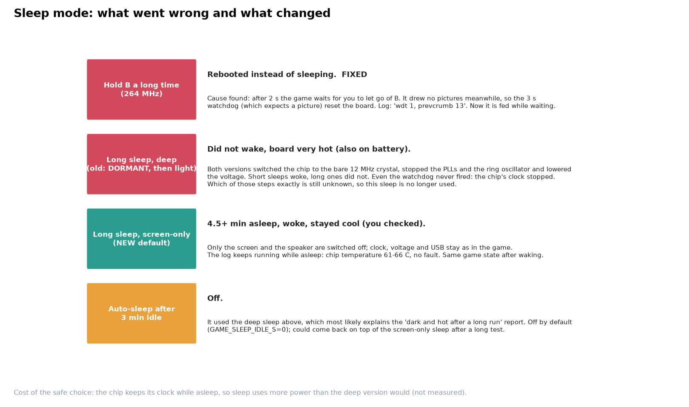
- User report: at 200 MHz / SPI 50 the board went dark after running a long time, B did not wake it and it was hot; a USB replug revived it. With sleep compiled out (`GAME_SLEEP=OFF`) a 5 minute idle soak ran clean (296 log lines, no `FAULT`, no reset, still on USB). That points at the sleep path, most likely the **automatic idle sleep** (3 min on a quiet screen), which the user never tested before. One clean run is evidence, not proof.
- Change: sleep is on again, but the automatic idle trigger is off by default (`GAME_SLEEP_IDLE_S=0`, CMake cache option). Manual sleep (hold B 2 s) is unchanged; the user verified it earlier at 400 MHz, not yet at 200 MHz.
- Verified: compiled, flashed, `SLP sleeps 0` in the log, 30 FPS, no fault. **Not verified**: hold-B sleep and wake at 200 MHz, and a long run with sleep on (need the user).
- Figures 16 and 17 were redrawn in Round 9 (script `docs/perf/crash_sleep_charts.py`).

### Round 8d: 400 MHz retried without idle sleep
Flashed 400 MHz / SPI 66.7 / dual core with `GAME_SLEEP_IDLE_S=0` at the user's request. It faulted again within seconds (`FAULT core 0 pc 200262a6`, fallback boot at 150 MHz), so the 400 MHz bug is **not** the idle sleep: the crash happens ~5 s after boot, the idle trigger needs 180 s. Reverted to 200 MHz / SPI 50. The idle sleep remains a suspect only for the separate "dark, hot, B does not wake after a long run" report, mechanism unknown.

## Round 9: the 400 MHz crash explained, new default 264 MHz @ 1.15 V
Plan (README first, per project rules): default clock 264 MHz, LCD SPI 66 MHz (divider 4), core voltage 1.15 V (auto table in `clock_init`: >300 MHz -> 1.30 V, >150 MHz -> 1.15 V). The arena guard (`GAME_ARENA_GUARD`, MPU) stays in the code, off by default. Results and figures below.
- **Sleep reboot fixed**: holding B longer than ~5 s rebooted the board instead of sleeping. After the 2 s trigger the game waits for B to be released, draws no frames meanwhile, so the frame-fed 3 s watchdog fired (log of the next boot: `wdt 1`, `prevcrumb 13`, never reached the sleep crumbs 20+). `sleep_service()` now feeds the watchdog while it waits (only with core1 idle, so a real hang still resets).

### Why 400 MHz crashed (figure 17)
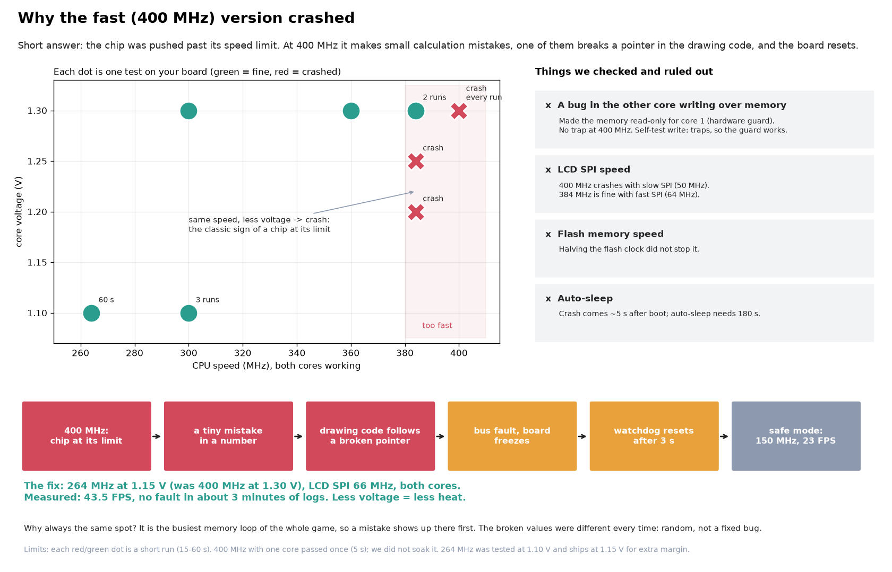
- **In simple words: the chip was run faster than it can reliably go.** Dual core, every test on this board (15-60 s each, log only):
  264 MHz @1.10 V ok (60 s, 43.4 FPS); 300 MHz @1.10 V ok (3 runs, 35.7 FPS with 50 MHz SPI); 300/360/384 MHz @1.30 V ok; **384 MHz @1.25 V and @1.20 V crashed**; **400 MHz @1.30 V crashed every run** (8 runs, ~5 s after boot, bus fault at the same drawing instruction `pc 0x200262a6`, a different broken pointer each time).
- Same clock, less voltage, crash: a speed/voltage limit of this chip, not a software bug (software does not care about the core voltage). The lower-voltage crashes hit random places (`__udivmoddi4`, an invalid jump), the 400 MHz ones hit the busiest memory loop of the game first.
- Ruled out: core 1 writing over the renderer memory (`GAME_ARENA_GUARD=1`: the MPU makes the 64 KB arena read-only for core 1; no trap at 400 MHz; `GAME_ARENA_GUARD=2` self-test write traps as `FAULT core 1 ... cfsr 00000082 mmfar <arena+4096>`, so the guard works); the LCD SPI rate (400 MHz with 50 MHz SPI crashed, 384 MHz with 64 MHz SPI fine); the flash clock (halved, still faulted); auto-sleep (needs 180 s, crash at 5 s).
- Not tested long: 400 MHz single core (one 5 s run without fault).
- **New default: 264 MHz @ 1.15 V, SPI 66 MHz, dual core** (tested at 1.10 V, shipped at 1.15 V for margin). Log: 43.5 FPS avg (min 40.6, 119 lines), no `FAULT`, no fallback.
- Also in this round: crumbs 10-17 in the frame loop, the HardFault recorder (`board/fault.cpp`), `clock_init` uses 1.30 V only above 300 MHz.

### Sleep (figure 16, redrawn)

- **Sleep, second problem (user)**: a short sleep woke fine, a long one did not wake and the board got hot. No erratum found for this (only RP2350-E9, GPIO input leakage, which does not fit a pulled-up button). Cause unknown, so the DORMANT sleep is replaced by a **light sleep** (`SLEEP_DORMANT=0`): crystal on (12 MHz), PLLs/USB/ADC clocks off, 1.10 V, both cores in WFI, a timer alarm every 20 ms checks B, and the watchdog (1 s) keeps running, so a failure now resets the board instead of leaving it dark and hot. Costs roughly 1 mA more than DORMANT (estimate, not measured). `SLEEP_DORMANT=1` keeps the old path for experiments.
- **Light sleep failed too** (user: long sleep, dark, B does not wake, "very hot", also on battery). The 1 s watchdog never reset the board, so the chip was not running at all. Next diagnostic (`SLEEP_SCREEN_ONLY=1`, current default): sleep turns off only the screen (DISPOFF/SLPIN, backlight) and the speaker; clock, voltage and USB stay as in the game, and the log prints `SLP alive <s> s temp <C>` every 2 s (die temperature, ADC4). It splits the suspects in half: clock/voltage change vs. screen/speaker/board.
- **Result**: the screen-only sleep slept 274+ s (log), woke with the same game state and stayed cool (user); die temperature 61-66 C while asleep, no fault. So the long-sleep failure lives in the deep part both old variants shared (switch to the bare 12 MHz crystal, PLLs and ring oscillator off, 1.10 V); the watchdog never firing in the light variant suggests the chip's clock stopped entirely. Which step exactly is not known. **Shipping: screen-only sleep** (`SLEEP_SCREEN_ONLY=1`), `SLP alive` log line every 10 s while asleep. It costs more power than a deep sleep would (not measured). Figure 16 redrawn.

### Round 9b: battery start problem (user report)
User: with the 264 MHz build the console shows nothing at all on battery (USB works); 150/200 MHz builds worked on battery. Test 1: same code at 200 MHz / SPI 50 MHz on battery. If it starts, the 264 MHz setting is at fault on battery power; if it stays dark too, suspect the battery (it ran very hot during the sleep failures) or the battery wiring.
Result: the 200 MHz build started on battery, and the user found the real cause: **a loose battery connection**, not the firmware. Back to the Round 9 default (264 MHz, 1.15 V, SPI 66 MHz, screen-only sleep).

### Round 9c: sleep power (figure 18, estimate)
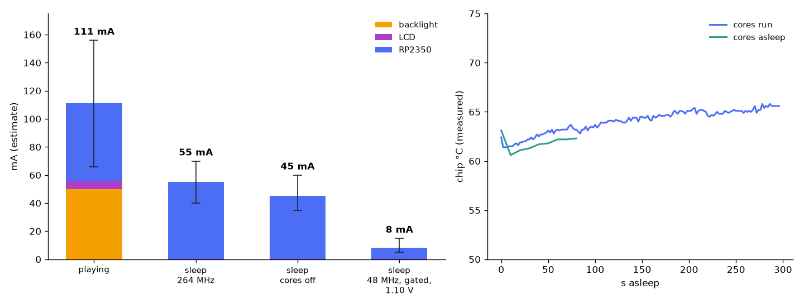
- **Estimate, not a measurement**: the board has no current sensor (it can only read VSYS/3 on ADC3 and its die temperature). Typical published numbers: backlight 20-80 mA (2.8" ILI9341 modules, typ. 50), ILI9341 controller ~6 mA active / ~0.1 mA after SLPIN, RP2350 at 264 MHz both cores a rough guess of 40-70 mA (scaled from ~16 mA idle at 150 MHz, Jeff Geerling). Speaker not counted.
- Result: playing ~111 mA (66-156), screen-only sleep ~55 mA (40-70): **sleep saves about half (39-55 %)**, all of it from the screen. Example 1000 mAh battery: ~9 h playing, ~18 h asleep (before regulator losses).
- **Measured**: die temperature while asleep rises from 62.4 C to 65.6 C over 296 s (`docs/perf/raw/sleep_screen_only_264mhz.log`): the chip itself saves nothing, it keeps 264 MHz / 1.15 V and core 1 keeps spinning. Cutting the chip's share needs a deeper sleep, and the deep variants failed on this board (Round 9).
- For a real number: USB power meter (USB power only) or an INA219 between battery and board. Script: `docs/perf/sleep_power_chart.py`.

### Round 9d: cores asleep too
Screen-only sleep, plus: core 0 waits in `WFI` (woken by a falling-edge GPIO interrupt on B, and by a 1 s alarm that feeds the watchdog and writes the `SLP alive` line), core 1 waits in `WFE` (`board_sleep_active()` flag, released with `__sev()` after the wake), and the 1 kHz sound timer is cancelled during sleep (it would wake core 0 1000 times a second). Clock and voltage stay unchanged (the deep variants failed). On USB, USB interrupts still wake core 0 (about 1 kHz); on battery there are none. The only on-board indicator is the die temperature in the `SLP alive` lines (compare with figure 18's curve).
- Result (user: woke to the same state, stayed cool): sleep of 81 s, `WAKE` at the same tick (5484, paused), no fault. **Measured die temperature**, same times into sleep, old (cores running) vs new (cores asleep): 10 s 61.5 vs 60.6 C, 40 s 62.5 vs 61.7 C, 80 s 63.2 vs 62.3 C, i.e. **~0.9 C cooler**, a small effect near the sensor's resolution; on USB the 1 kHz USB interrupts still wake core 0. Figure 19 = old, figure 20 = new (same axes, script `docs/perf/sleep_temp_charts.py`, logs in `docs/perf/raw/`). Figure 18 now has a third bar: ~45 mA (35-60) with the cores asleep, **estimated** from that temperature drop, not measured.

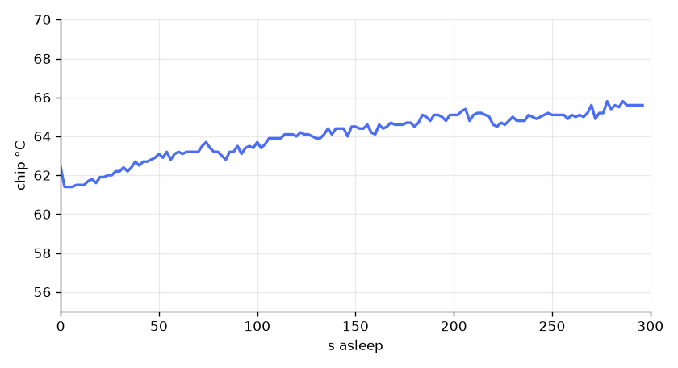
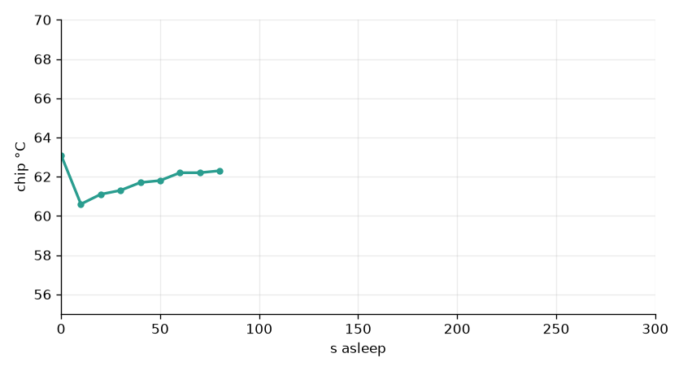

### Round 9e: slower clock while asleep (step 1 of 3)
Goal: get the sleep current toward a few mA without the steps that failed (bare crystal, PLL/ring oscillator off, voltage drop). Step 1: while asleep the system clock drops from 264 MHz to 48 MHz **through the PLL** (crystal and PLL keep running, 1.15 V unchanged, peripheral clock follows), restored before the screen wakes. Step 2 (next): gate unused peripheral clocks during sleep (`SLEEP_EN` registers). Step 3 (only if 1+2 pass): voltage. Each step = one build and one 4-5 min sleep test by the user.
- Step 1 result: woke at the same tick (2473, paused) at 264 MHz after sleeping at 48 MHz (`SLP alive ... sys 48000 kHz`), user: "woke, same state, cool". The user ends tests by pressing B; no more long timed logs (user request).
- Step 2: both cores set `SLEEPDEEP` while asleep (core 0 in WFI, core 1 in WFE), so the chip's clock gating (`CLOCKS SLEEP_EN0/1`) applies. Gated: PWM, PIO0-2, DMA, ADC, SPI0/1, UART0/1, I2C0/1, HSTX, SHA256, TRNG, TIMER1, JTAG, TBMAN. Kept: SRAM, XIP, ROM, bus fabric, SIO, IO/pads, TIMER0, ticks, watchdog, XOSC, both PLLs, USB, clocks/resets/PSM/POWMAN/OTP/glitch detector. The hardware turns every clock back on at the wake; the registers are restored to all-on afterwards.
- Step 2 result: 17.7 s sleep, woke at the same tick (1767), no fault, 43.7 FPS after; user: "woke, same state, cool". Note: the die-temperature readings taken right after each wake are unreliable from step 1 on (64-68 C at 10 s, 59-60 C at the wake): the ADC was gated/the clock changed just before; not used as data.
- Step 3: while asleep at 48 MHz the core voltage goes from 1.15 V to 1.10 V (the stock voltage, rated for 150 MHz; never lower, 0.90 V trips the brown-out reset). Order: clock down then voltage down; on the wake voltage up, 1 ms settle, then clock up.
- Step 3 result: log `sys 48000 kHz, vreg 11 = 1.10 V` while asleep, 13.9 s sleep, woke at the same tick (1183, paused), 44.3 FPS after, no fault; user: "woke, same state, cool". **Shipping sleep = screen + speaker off, both cores in deep sleep (WFI/WFE), 48 MHz through the PLL, unused clocks gated, 1.10 V.**
- Figure 18 has a fourth bar: ~8 mA (5-15) for this sleep. **Estimate, not measured**: published Pico 2 MicroPython lightsleep is ~4 mA for the whole board (Jeff Geerling); ours keeps the PLL, USB and more clocks running. A meter is needed to confirm the user's expected ~2 mA.

### Round 9f: temperature run (play quiet -> crowd -> sleep -> wake), test build `GAME_TEMP_TEST=ON`
Hands-free, ~4 min: 0-5 s boot, 5-45 s quiet play (sphere level 1, AI player), 45-125 s crowd (level 8, the benchmark's CROWD scene), 125-215 s sleep (the Round 9e sleep, woken by the test after 90 s), then 30 s crowd again. A `TMP <ms> ms phase <name> temp <C>` line every 2 s, also while asleep. The AI games run in benchmark mode (no high-score saves). The die-temperature read now throws away its first conversions after selecting the sensor (the readings right after a wake were off).
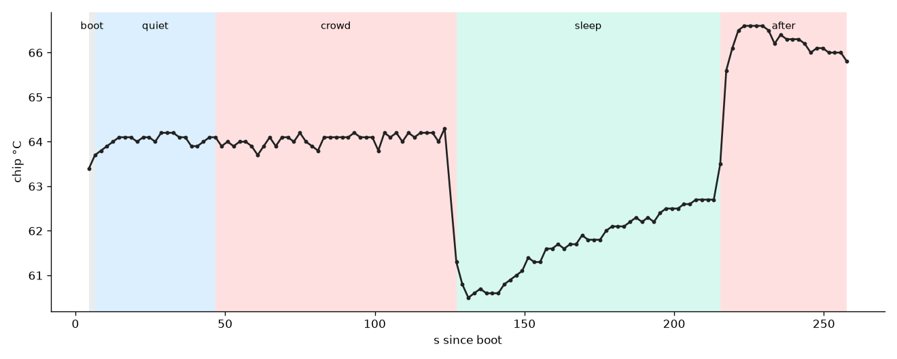
- Result (log `docs/perf/raw/temp_run_264mhz.log`, 163 `P0` lines, 38.3 FPS avg while playing, no fault, sleep 90 s and auto-wake at the same tick 2717): quiet 47.2 -> 49.4 C, crowd 49.6 -> 53.1 C, **sleep 50.2 -> 67.7 C**, after the wake (crowd again) 55.8 -> 59.0 C.
- Reading it: the jumps at the sleep entry (+10 C in 2 s) and at the wake (-12 C in 2 s) are too fast to be real heat; the sleep configuration (1.10 V / 48 MHz / ADC clock gated between reads) shifts the sensor reading, so the absolute numbers during sleep are not comparable with the awake ones. Two things still look real: the steady rise during the sleep (+7 C in 85 s) and the chip coming back ~3-6 C warmer at the same crowd load than before the sleep. So this sleep does **not** cool the chip and may heat it (consistent with the earlier "hot while asleep" reports). Not resolved; next check: the same run with the ADC clock not gated and the voltage left at 1.15 V during sleep.
- `GAME_TEMP_TEST` builds play in benchmark mode by themselves; flash a normal build afterwards (done).
- **Hypothesis for the hot sleep**: not the clock/voltage (the screen-only sleep at 264 MHz / 1.15 V warmed too, 62 -> 65.6 C), but something every sleep variant does: `sound_suspend()` drove the speaker pin GP15 hard low ("transistor off" assumes the NPN circuit above; on the user's Picopad board low may mean on), and/or the LCD sleep. A large DC current at the sleep entry would explain the sudden reading jump (supply sag shifts the sensor reading) and the slow warming. Test: GP15 goes to its power-on state (input, pull-down) while asleep, same `GAME_TEMP_TEST` run.
- Speaker-pin test: **disproven** (GP15 high-Z while asleep: sleep readings still 67 -> 75 C, still jumping; log `docs/perf/raw/temp_run_264mhz_pin_hiz.log`; the pin change is kept, it is the power-on state). The sleep readings also swing back and forth (67.3, 67.7, 62.2, 71.6 C within 6 s), which no real temperature does. Next hypothesis: the board's 3.3 V switching regulator goes into its power-save mode (PFM) at the low sleep load, its ripple disturbs the ADC (which measures against 3.3 V). Test: GPIO23 (`PICO_SMPS_MODE_PIN`) high = PWM mode for 2 ms around each temperature read, then back to power-save.
- **Confirmed: the "hot sleep" was a measuring error.** With GPIO23 high (3.3 V regulator in PWM mode) for each read: quiet 64.0 C, crowd 64.1 C, **sleep 61.7 C avg (60.5-62.7, no jumps)**, after the wake 66.1 C (log `docs/perf/raw/temp_run_264mhz_smps_pwm.log`). In power-save mode the regulator's ripple shifted the ADC reading by up to +11 C at the low sleep load. Figure 21 is now this corrected run; figure 22 shows the same run measured both ways. Figures 19/20 and the first run were measured without the fix (the 264 MHz sleep of fig. 19 has more load and fewer jumps, but its absolute values are not trustworthy either).
- Left over: even measured correctly the chip warms slowly while asleep (+2.2 C in 85 s) and settles ~2 C above the pre-sleep crowd level after the wake; cause not known (the board may still be warming overall during these back-to-back runs).

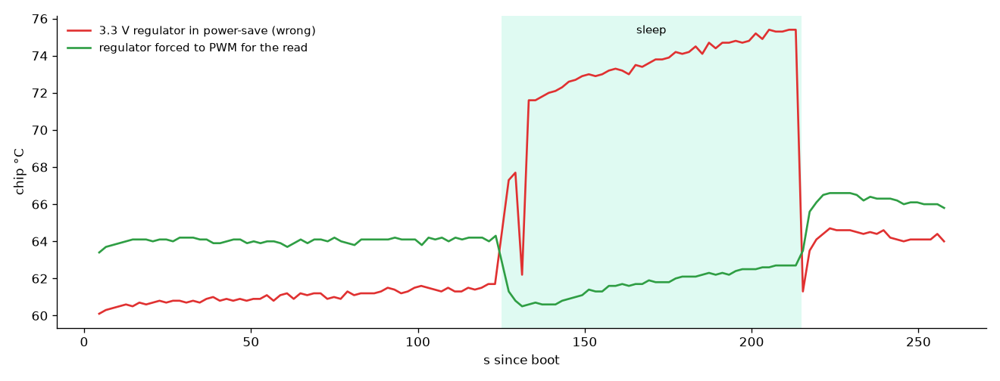

## Round 10: datasheet fixes for the warm sleep + core temperature indicator
User report: the console gets hot when it sleeps/idles for a long time. Source for every change: the RP2350 datasheet in the workspace (`RP-008373-DS-3-rp2350-datasheet.pdf`, text pulled out with `tools/ds_text.py`). Firmware only: no wiring changes, no meters. Every change is listed in **`docs/datasheet/IMPLEMENTATION.md`** with its datasheet section, the code location and its status; keep that file up to date with each change touching power, clocks, pads or sleep.

Planned (CLAUDE.md "Round 9g", steps 1-5; step 6 POWMAN P1 is left for later):
1. Speaker pin GP15 driven low with input disabled while asleep (RP2350-E9, App. D.5.1).
2. Input enable off (and the button pull-ups off) on every GPIO except the wake pin B (GP9) while asleep, restored on wake (RP2350-E9).
3. Sleep clock 64 MHz instead of 48 MHz: `clk_sys` must be >= 10 % faster than `clk_usb` (48 MHz) with USB in use (RP2350-E12, App. D.11.1).
4. `SLEEP_EN0/1` reduced to the wake minimum (datasheet §6.5.2 / §8.1.6.6 example), USB clocks kept only if USB is mounted. `SLEEP_GATE_LEVEL` steps back if a wake fails.
5. `GAME_TEMP_TEST` builds keep their `TMP` samples in a RAM ring and dump it when USB comes back (battery runs).
6. New: **core temperature indicator** under the FPS box (die sensor ADC4, datasheet §12.4.6), read once a second without blocking the frame.

### Round 10 test 1 (all of steps 1-4, gate level 3): did not wake
- Log: boot fine (`fallback 0`, ~43 FPS, `TEMP level 1 -> 2 at 60.0 C`, indicator amber on screen). `SLEEP enter` then `SLP alive 0 s ... sys 64000 kHz, vreg 11 = 1.10 V, chip A2, pads IE-off 9, gate level 3 en 25e22001 500e0000 usb 0`, then nothing. The user: B did not wake it; the board left USB and did not reset by itself.
- `chip A2`: this board **is** the stepping hit by RP2350-E9, so steps 1-2 apply.
- Bug found: `usb 0` on USB. GPIO24 (VBUS sense) was never initialised, so its input buffer is off since reset and it always reads 0: the USB clocks were gated with the cable in, the link dropped and the log went blind. Fixed: IE on only for that read (the E9 workaround in the datasheet: enable IE right before the read, disable again).
- Not explained: why B did not wake. No watchdog reset happened, so something kept feeding the watchdog (the sleep loop or the frame loop with a dark screen), or the gating also stopped its tick. Following the planned fallback order: `SLEEP_GATE_LEVEL` 2 (bus fabric + SRAM0-9 clocked while asleep), breadcrumbs 44/45 around the `WFI` and 46 after the pads restore.

### Round 10 test 2 (gate level 2): first sleep woke, second did not
- Sleep 1: `SLP woke after 1595 ms`, `WAKE` at the same tick (2205). Sleep 2 (tick 2555): no wake, log ends, board off USB.
- Both lines say **`usb 0` with the cable in**, even with IE on for the read: GPIO24 is no usable VBUS sense on this board. So every failed sleep of this round gated the USB clocks while connected; Round 9e (USB never gated) always woke.
- Change: USB clocks (`CLK_USB`, `CLK_SYS_USBCTRL`) always stay on in sleep; cost ~1.25 mA DVDD (datasheet Table 1691), not a heat source. VBUS check removed.

### Round 10 test 3 (gate level 2, USB kept clocked): USB stays up in sleep, still no wake
- `usb 1`, gating `en 25e22041 5c0e3ff0`; the log kept running in sleep (`SLP alive 10 s temp 62.9 C`) until the log window ended; the user's B press afterwards did not wake it, the board left USB, no reset.
- So far the only wake of this round was a 1.6 s sleep; all longer ones failed, and none ended in a watchdog reset (something keeps feeding it: the sleep loop not seeing B, or the game running with a dark screen and dead USB).
- Bisect at the largest step: test 4 = gating back to the Round 9e mask (`SLEEP_GATE_LEVEL` 0) with all other Round 10 changes kept (E9 pins, 64 MHz, USB on), `SLP alive` every 2 s and flushed `SLP wake 1/2/3` lines in the wake path.

### Round 10 test 4 (Round 9e gating, all other Round 10 changes): woke twice
- Log: `SLP alive 0 s ... sys 64000 kHz, vreg 11 = 1.10 V, chip A2, pads IE-off 9, gate level 0 ... usb 1`; sleep 1 12.5 s, sleep 2 19.2 s, both `SLP wake 1/2/3` and `WAKE` at the same tick (1641, 2467), no `FAULT`, `fallback 0`. User: "both woke, cool".
- Die temperature fell while asleep (60.2 -> 57.1 C, 60.6 -> 58.3 C) and climbed back to ~60 C in play. The core indicator switched WARM -> OK in sleep and back (`TEMP level` lines).
- **Conclusion of the bisect**: the datasheet-minimum `SLEEP_EN` gating (levels 3 and 2) is what broke the wake on this board (tests 1-3). Shipping: level 0 (the Round 9e mask) + USB clocked + E9 pin fixes + 64 MHz. Level 1 (keep XIP/ROM/SIO too) is untested; the extra saving of levels 1-3 is a few mA at most (Table 1690: XIP 37.6 uA/MHz = ~2.4 mA at 64 MHz), so it is not where any heat comes from.
- **Core temperature indicator**: under the FPS, `CORE nnC` green < 60 C, amber >= 60 C (WARM), red box with blinking `HOT! nnC` >= 70 C; each level is left 2 C below its threshold. One read per second, non-blocking (GPIO23 high, read on a later frame >= 2 ms after, ~50 us). The HUD starts 11 px lower to make room (`FPS_OVERLAY_RESERVED_H` 25). On this board in play at 264 MHz: 58-69 C, i.e. mostly amber. Limits from the datasheet: junction 125 C abs. max, ambient 85 C; thresholds are kept far below because the sensor depends on the 3.3 V reference (~4 C per 1 %).
- Not verified: a long sleep (several minutes) with these changes; `GAME_TEMP_TEST` battery ring (compiled only); the indicator's look on the LCD (PC render only).

## Round 11: scheduling between the two cores, benchmarked
User question: which scheduling do we use, and is it the best one when two cores share the work?

**Current scheme (measured, 264 MHz, log of Round 10)**: a fixed *functional pipeline*. Core 0 does everything on the display path: `begin_frame` (scene build, ~3.7 ms), rasterising the 6 bands (~17 ms, of which the planet surface is ~13 ms), and feeding the SPI DMA. Core 1 runs only the simulation batch (~6.6 ms per frame, started late in the frame for fresh input, `GAME_LATE_LAUNCH`) and, in between, slices of the next world's surface. Core 1 is busy about 30 % of the frame; core 0 is the critical path. Frame period 23.2 ms; one full-screen SPI transfer is 20.5 ms (66 MHz, the panel's limit), so the hard ceiling is ~48.8 FPS: at most ~12 % to win.

Plan: add a dynamic work-sharing mode for the planet surface (`GAME_PLANET_SHARE`): each band's planet rows are cut into small chunks that both cores claim from a shared atomic counter; core 1 helps whenever it is not running the sim (priority sim > planet chunks > world building), core 0 never waits for core 1 except for a chunk already in flight. Then benchmark (hands-free `tools/perf_run.py`, benchmark scenes + paced AI demo): single core, pipeline with early launch, pipeline with late launch (current), work sharing with late and early launch, and chunk sizes.

### Round 11 results (264 MHz, SPI 66 MHz, `tools/perf_run.py`, logs `docs/perf/raw/r11_*.log`)
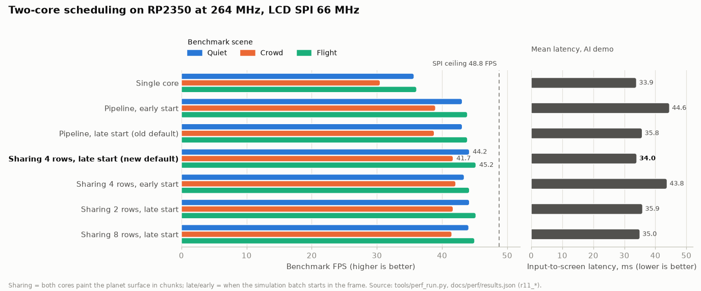

Figure 23 (script `docs/perf/sched_chart.py`, reads `docs/perf/results.json`): benchmark FPS per scene with the 48.8 FPS SPI ceiling, and the demo's input-to-screen latency, for every scheduling variant.

Benchmark scenes QUIET / CROWD / FLIGHT (FPS), raster time per frame on core 0 (QUIET/CROWD), and the paced AI demo (FPS, input-to-screen latency mean/max, frame period mean/max). "help" = share of the planet chunks painted by core 1.

| Scheduling | FPS Q / C / F | raster ms | demo FPS | latency ms | period ms | help |
|---|---|---|---|---|---|---|
| single core | 35.7 / 30.5 / 36.1 | 17.3 / 19.1 | 32.7 | 33.9 / 36.1 | 30.6 / 34.7 | - |
| pipeline, early launch | 43.1 / 39.0 / 43.9 | 17.5 / 19.4 | 44.3 | 44.6 / 47.8 | 22.5 / 25.8 | - |
| pipeline, late launch (old default) | 43.1 / 38.8 / 43.9 | 17.5 / 19.4 | 43.6 | 35.8 / 42.4 | 22.9 / 25.8 | - |
| **sharing 4 rows, late launch (new default)** | **44.2 / 41.7 / 45.2** | **12.6 / 15.2** | 45.1 | **34.0 / 41.3** | 22.2 / 26.5 | 36 % |
| sharing 4 rows, early launch | 43.4 / 42.1 / 44.2 | 12.1 / 14.4 | 45.4 | 43.8 / 47.2 | 22.0 / 25.5 | 30 % |
| sharing 2 rows, late launch | 44.2 / 41.7 / 45.2 | 12.6 / 15.2 | 43.8 | 35.9 / 42.4 | 22.9 / 25.6 | 36 % |
| sharing 8 rows, late launch | 44.1 / 41.5 / 45.0 | 13.5 / 15.9 | 44.3 | 35.0 / 43.1 | 22.6 / 27.3 | 42 % |

- **Work sharing is the best scheme measured**: +2.6 % / **+7.5 %** / +3 % FPS over the old pipeline (the crowd scene gains most: it is the most CPU-bound), core 0's raster time drops by ~5 ms (planet paint 13 -> 9 ms on core 0), latency unchanged or slightly better. No `FAULT`, no fallback in any run.
- Why not more: the frame is now **SPI-bound**. Core 0's `wait` for the DMA rose from ~1 ms to ~5 ms per frame: it finishes its bands before the panel has taken the previous one. The frame (22.2 ms) is 1.7 ms above the 20.5 ms transfer floor; that rest is the frame start (scene build `begin_frame` ~3.5 ms, during which only the last band's transfer runs) and cannot be shared, because it needs the finished simulation state. The SPI rate cannot go up (panel garbles above 66.7 MHz).
- Early vs late launch: same FPS, but early launch costs ~9 ms of input latency (sim input sampled a frame earlier). Late launch stays.
- Chunk size barely matters (2 = 4 rows; 8 rows lets core 1 take more but its last chunk delays core 0 more). 4 rows kept.
- Core 1 paints 36 %, not 50 %: during the last part of each frame it runs the sim batch (priority), so core 0 paints those bands alone.
- The atomics are safe across both cores per the datasheet §2.1.6 (Global Exclusive Monitor: exclusives work in all main SRAM 0x20000000-0x20082000; the counters are in `.bss`).
- The two benchmark builds that failed first (single core, early launch) failed at the flash step (`picotool reboot` could not reach the board), not in the build; rerun, results above. Two old warnings that only appear in those configurations (`g_injectUntilMs` without the intro, `late_launch_hook` without late launch) are fixed.
- Verified by the user on the LCD: planet surface clean with sharing on ("looks clean").

## Round 12: core 1's idle time for an animated surface, whole music tracks, louder music
The time-utilisation chart (figure 25) shows core 1 idle ~59 % of a frame and core 0 waiting ~24 % on the SPI. The frame is
SPI-bound (20.5 ms floor), so more compute cannot raise the FPS much; the idle time goes to looks that cost core 0 nothing.
- **Animated surface** (`GAME_PLANET_ANIM`, default ON with the sim on core 1): core 1 rebuilds the world's colour table
  (`g_lut`, 256 heights x 32 shades) in slices of 16 heights from its idle loop (`planet_anim_poll()` after the chunk help
  and world build), one pass every 20 ms. The colour of a height then moves with time: surf lines and shimmering water on Terra, flowing
  lava, ice glints, an alien glow pulse, slow dust on Mars. Core 0 paints with the same table lookup as before (no FPS cost),
  no new buffers (a 512 B sine table). A world change (`gen_commit` on core 0) may meet a slice in flight: for up to one pass
  (~20 ms) some heights keep the old world's colour.
- **Whole tracks**: `make music` now packs the complete tracks (`MUSIC_WINDOW=0`, 160 s + 264 s, ~3.3 MB of the 3.58 MB
  area) instead of 75 s windows. `MUSIC_WINDOW=75` gives the old pack.
- **Louder music**: the tracks already hit the limiter (peak 0 dBFS; +7 dB of drive only gave +0.7 dB RMS), so the headroom
  comes from the bass the small speaker cannot play: `tools/music_pack.py` now uses a 4-pole high-pass at 180 Hz (`--hp`),
  +3 dB at 2 kHz (`--presence`, kept mild: "the high tones are too much" in Round 2) and 8 dB into the limiter (`--drive`).
  Round 6 chain = `--hp 90 --presence 0 --drive 5`.

### Round 12 results
| | Measured | Where |
|---|---|---|
| Benchmark FPS quiet / crowd / flight | 44.3 / 41.7 / 45.3 with and without the animation | `r12_anim_off`, `r12_anim_on2` (board) |
| AI demo FPS | 44.83 off, 44.82 on (standard error 0.14) | same runs, P3 lines |
| Input-to-screen latency (demo) | 34.9 ms off, 34.3 ms on | same runs |
| Core 1 time in the animation | 0.8-0.9 ms per frame (4 %) | `PLN ... anim` |
| First version (float pack, 32-height slices) | 43.86 FPS demo (-1 FPS), 1.1 ms per frame | `r12_anim_on`: a late sim launch waited behind a slice. Fixed with an integer inner loop and 16-height slices |
| Music length | 75 s + 75 s -> 160 s + 264 s, 3,281 KB of 3,580 KB | packer |
| Loudness above 200 Hz, same passage | +1.8 dB (track 1), +1.9 dB (track 2), same peaks | `tools/music_levels.py` on the PC (figure 26) |
| Full-band level on the board | `music-rms` 40-41 (track 1), 33-35 (track 2); before 39-43 / 34-37 | `r12_music_test.log` (`GAME_INPUT_TEST`) |
| Decoder self-test, new pack | `selftest 1` (bit-exact) | board |
| RAM | +3.7 KB (2.5 KB code in RAM, 512 B sine, 768 B base colours); the star field shrinks by that | `arm-none-eabi-nm` |
| Firmware | 275 KB (limit 512 KB) | `out/game.bin` |

The board's `music-rms` is full band, so it cannot show the gain: the bass that was removed is replaced by energy in the band
the speaker plays. Whether it sounds louder needs a listen. Not checked by a person yet: the look of the animated surface
on the LCD and the loudness by ear. Figures: 24 (memory), 25 (time utilisation, now with the animation), 26 (music).
Previews: `tools/anim_preview.cpp` (strip `docs/worlds/surface_anim.png`).

## Round 13: more of core 1 for the surface animation (integer only)
Round 12 used 4 % of core 1 (colour table only). Round 13 also moves the world itself, still at no cost to core 0:
- **Height map** (`cubeRow`, 6 x 64 x 64): the low ground of every world gets three crossing waves (phase from the
  texel's point on the cube surface, so no seams at face edges): Terra's sea, with the beach (88..101) washed over (it only
  dips, never rises); Lava's bright edge creeps; Alien pools breathe; dust rolls through Mars' basins; a slow swell moves
  under Ice. Land above the band is never touched.
- **Ground tiles** (`layerRow`, hills + grain 64 x 64, tile-able patterns): wind gusts in Terra's grass, dust and dunes
  on Mars, blowing snow on Ice, flowing lumps on Lava, ripples and breathing hills on Alien. Water and lava rows of the
  colour table now also ripple with the shade, so the animated grain makes ripples run across the water near the player.
- **Colour table**: the Round 12 effects, now integer, plus slow cold light bands on Ice.
- **No new buffers**: the still copies of the height map and tiles live in the *back* world set, idle between world
  changes. While a world is being built (gen active or waiting for its commit) the height map and tiles pause; after each
  commit (`g_commits`) the new world is copied there first. The first world is built on core 0 before anything animates.
- **Scheduling**: work is split into units (one table height or one texel row, a few us). Between units the animation
  yields to a waiting sim batch, an open planet chunk job, and core 0's `Renderer::beginFrame` (`g_core0Critical`); in
  `beginFrame` core 1 sleeps in `WFE` and core 0 wakes it with `SEV`.

### Round 13 results (board, 264 MHz / SPI 66 MHz)
| | Measured |
|---|---|
| Core 1 time in the animation | 0.8 ms (Round 12) -> Terra 3.4, Mars 3.0, Ice 3.1, Lava 3.3 ms per frame (figure 27) |
| Core 1 busy (time utilisation, figure 25) | 41 % -> 58 % (sim 27 %, planet chunks 15 %, animation 16 %) |
| Benchmark FPS, Terra forced, off / on | 44.4 / 41.9 / 45.4 vs 44.4 / 41.8 / 45.4 (`r13_terra_off3`, `r13_terra_on3`) |
| First try, long slices (`r13_anim`) | -0.8 FPS in the demo: the late sim launch waited behind a slice. Fixed by the yield |
| Yield without the WFE (`r13_terra_on2`) | benchmark equal; `begin` looked +0.4 ms in the demo, but the animation-off run with the same firmware otherwise (`r13_terra_off3`) showed the same `begin`: demo variation, not the animation |
| Core 1 asleep (WFE) during `beginFrame` | benchmark +0.1 / +0.2 / +0.1 FPS, with or without the animation (`r13_terra_off` vs `r13_terra_off3`) |
| Current build (`r13_ship`, random world: Alien) | benchmark 44.4 / 41.8 / 45.4, latency 35.3 ms, 22.6 ms per frame, core 1 paints 36.7 % of the planet, animation 3.0 ms |
| Audio interrupt at 264 MHz | 1.6 % of core 0 playing (137 cycles), 0.6 % silent (53 cycles); Round 6's 0.9 % was at 400 MHz (figure 15 redrawn, `docs/perf/music_pack_chart.py`) |
| AI demo, run to run | varies about +-0.5 FPS between runs even on the same world (`r13_terra_off` 45.1 vs `r13_terra_off3` 44.2, both animation off), so the fixed benchmark is the measure |
| RAM | +2.8 KB over Round 12 (5.3 KB animation code in RAM in all); the star field shrinks by that |
| Firmware | 277 KB (283,488 B) |
| Star field | 1,725 stars = 13,800 B of 15,916 B free heap (`r13_input_test`) |

Test switch: `GAME_PLANET_DEFS=PLANET_FORCE_STYLE=n` forces one world style (benchmark A/B on one world).
`wdt 1` with a random frame-loop `prevcrumb` after a flash is `picotool`'s forced reboot (seen in every run since Round
11, also before these changes), not a hang; a power-up shows `wdt 0`. Not checked by a person yet: the look on the LCD.

## Round 14: hot sleep, possible pin shorts (firmware only)
User report: the board still gets very hot asleep, and pins that "are not important" may be shorted on the board, so the
firmware must not assume unused or idle pins are open. Facts so far: the die read ~62 C asleep vs ~64 C playing
(Round 9f, corrected read), although the chip itself uses only a few mW asleep (datasheet Table 1690); something
dissipates steadily in both states. Until now the sleep switched inputs (IE) and pulls off but left every output
driven: LCD backlight/DC/SCK/MOSI/RST/CS (GP16-21) and the speaker pin GP15 (low). A driven pin into a short sources
tens of mA (datasheet Fig. 154; bank limit I_IOVDD_MAX 100 mA, Table 1682), dissipated in the chip's pad.
- **Pin probe** (`src/board/pin_probe.*`, at boot before any pin is driven): every header GPIO (GP0-22, GP26-28) is read
  with only its pull-up and only its pull-down (each after a 2 us pre-charge, so RP2350-E9 cannot fake a level), then
  every pin is pulsed high and low for a few us at 2 mA drive while the others listen through pulls: ties to GND
  (`G`), to 3V3 (`V`) and pin-to-pin shorts are logged as a `PINS` line every 5 s. GP15 (speaker base) is only read.
- **Sleep pins high-impedance**: `OD` (output disable, datasheet p. 706, priority over peripheral output enables) on
  every driven header pin while asleep; CS/RST held by their pull-ups, backlight/DC/SCK/MOSI/speaker by pull-downs,
  except where the probe found a tie to the other rail (no pull at all there). GPIO23-25/29 are internal board nets,
  untouched. Wake restores the saved pad registers.
- **Probe result on this board** (3 identical reports, `PINS gnd 12,15,16,22 vdd 0 odd - shorts 7-8,11-13`): GP12 and
  GP22 tied to GND, GP0 tied to 3V3, GP7-GP8 and GP11-GP13 connected; GP15 (speaker base) and GP16 (LCD backlight
  input) are loads, as expected. None of these is a pin the firmware drives (LCD GP16-21, speaker GP15), so pad current
  into a short is not shown to be the heat source; the high-impedance sleep removes that path anyway. Side finding:
  GP11 ("B") reads pressed because it is connected to GP13, whose reset pull-down fights GP11's pull-up.
  Build: no warnings, +208 B RAM, firmware 279 KB; flashed, boots, `fallback 0`, 45 FPS.
- **Sleep test 1 (user)**: with every pin released the die still read 64.8 C at sleep entry, 61.8 C at 10 s, 62.0 C at
  20 s: no change from Round 10, so released pins did not reduce the heat. User: the heat is on the chip; the first
  sleep woke, a longer second one did not (board off USB, no watchdog reset; full power cycle needed). Since Round 10
  the shipping sleep had only been tested for 12-19 s (Round 9d/9f sleeps of 81-90 s woke).
- **Reverted (user request)**: all Round 14 firmware changes removed (pin probe, pin release, a prepared LED-heartbeat
  diagnosis build that was never flashed). The board runs the Round 13 firmware again, the version the presentation
  describes: rebuilt with identical section sizes (283,488 B), flashed, log: 264 MHz / SPI 66 MHz, `fallback 0`, 44 FPS,
  `anim 1`, `selftest 1`, no `PINS` line. The probe findings above stay as information only.
  Open: the long-sleep wake failure (seen with the Round 14 build; long sleeps were never tested with the Round 10-13
  sleep) and the heat (die ~62 C asleep, about the same as play).


## Round 16: new board with an ST7789 panel
The user changed the board and some connections; the panel is now an **ST7789** (same 240x320 size and the same
command set we use: SWRESET, SLPOUT, COLMOD 0x55, MADCTL, DISPON, CASET/RASET/RAMWR, SLPIN/DISPOFF).
Two differences seen on the LCD with the ILI9341 settings: colours inverted, picture flipped vertically.
- `INVON` (0x21) is sent after COLMOD only when `LCD_INVERT` is 1 (CMake `GAME_LCD_INVERT`, default **0**). Tried 1 first:
  the user saw inverted colours with it; the old colour settings (no INVON, BGR) are correct on this panel.
- Landscape MADCTL is now `0xA0` (MY|MV, RGB) instead of `0xE8` (MY|MX|MV|BGR): with MV set, MX mirrors the logical
  y, so dropping MX flips the picture vertically; the BGR bit is cleared because this ST7789 module is RGB-ordered
  (root cause of the colours, below). Override with `-DGAME_LCD_MADCTL=0x..` if needed (`0x28` = 180 degrees from this,
  `0xE8` = old ILI9341 value). If red and blue look swapped, clear the BGR bit (0x08), e.g. `0xA0`.
- Colours, root cause: with the ILI9341 settings the user saw terra's blue sea orange (land still green), mars bluish,
  glacier white/orange: red and blue exchanged, green and black/white unchanged = the panel's colour order. The
  ILI9341 module is BGR, this ST7789 is RGB, so MADCTL bit 3 (BGR) is now 0. A first guess (pixel bytes swapped, DMA
  swap off) was wrong: it gave noise and pink blues, because the framebuffer is stored byte-swapped and the DMA swap
  (`LCD_BSWAP`, CMake `GAME_LCD_BSWAP`, default 1) is needed on both panels. INVON was also wrong (inverted colours).
- All three are in `SHIP_ARGS` (Makefile), so a stale CMake cache cannot bring back the old values.
- Pins (`board_pins.h`) unchanged unless the user gives new numbers.

### Round 16b: battery current measured (new board)
The user measured the current at the battery (3x AA, 1.5 V each, ~4.5 V into VSYS, meter in series, USB unplugged):
**idle ~100 mA, playing ~120 mA, sleep ~10 mA** (about 0.45 / 0.54 / 0.045 W at 4.5 V). These agree with the Round 9
estimates (figure 18: playing ~111 mA, range 66-156; Round 9e sleep ~8 mA, range 5-15; those were 3.3 V-rail figures
without regulator loss). The earlier board's 380/200 mA readings came from a hardware fault on that board (it drew
over 2 A even in BOOTSEL), not from the firmware. Figure 28 (`docs/perf/power_measured_chart.py <out> <matplotlib dir>`):
the measured currents, and the sleep revisions R9 -> R9d -> R9e (estimate ranges, converted to mW) -> R10 (measured).
Deck: new slide "Battery current, measured" after the errata slide; the limits table no longer says power cannot be
measured. The left half of figure 28 plans with a **200 mAh** battery (user's choice): 1 h 40 min playing, 2 h idle,
20 h asleep (ideal capacity), plus a **guesstimated** split of the power per mode (RP2350 / backlight / speaker / LCD
controller / regulator + other; sleep ~50 % chip, ~45 % regulator and the rest). The split is not measured.

### Round 16c: music high frequencies cut (distortion)
The new board had no music pack (`SND pack no tracks`); `make music` loaded it. The user then heard distortion from
the high frequencies. Packer change (`tools/music_pack.py`): the Round 12 presence lift (+3 dB at 2 kHz) is off by
default, and the 7 kHz low-pass is replaced by a steep one at **3.5 kHz** (two 2-pole low-passes, `--lp`, 0 = old
7 kHz single stage). Old chain: `--presence 3 --lp 0`. Firmware unchanged; only the music area is rewritten.

### Round 16d: third track (synthwave)
The user added `docs/music/synthwave.mp3` (2:13). All three whole tracks (160 + 264 + 134 s) would need ~4.4 MB, the
music area holds 3,580 KB (~458 s at 7.8 KB/s), so the pack keeps the most energetic **150 s** of each
(`make music MUSIC_WINDOW=150`; synthwave fits whole). Tiers -> tracks with 3 tracks (`tier * 3 / 4`, file name
order): tiers 0-1 leberch, tier 2 sub_clair, tier 3 (most intense) synthwave. Same filter chain as Round 16c.

### Round 16e: synthwave only
User: remove the older (Pixabay) music. The two Pixabay MP3s moved to `docs/music/old_pixabay/` (outside the
`make music` glob, files kept); the pack holds only `synthwave.mp3`, whole (133.5 s, ~1,033 KB of 3,580 KB), played on
every tier (one track: `tier * 1 / 4` = 0). Why three did not fit: 4 MB flash - 512 KB firmware - 4 KB scores
= 3,580 KB; 4-bit ADPCM at 15.625 kHz = 7.8 KB/s, so ~458 s in total. The synthesized tune stays in the firmware
as the no-pack fallback.

### Round 16f: joystick up/down inverted on the new board
User: up and down are inverted. The stick's VRx (GP26) carries up/down (mounted sideways). New switch `JOY_INVERT_UD`
(CMake `GAME_JOY_INVERT_UD`, default 1, in `SHIP_ARGS`) flips the analog up/down axis and the digital UP/DOWN bits
together (menus and play stay consistent); left/right unchanged. 0 = old board's orientation.

### Round 16g: thank-you slide
The deck ends with a "Thank you" slide crediting **ShapoGFX** (Shapoco, MIT, github.com/shapoco/shapo-gfx: the 2D/3D
renderer), the Raspberry Pi pico-sdk (BSD-3-Clause), the RP2350 datasheet and the music. No game-core credit on the
slide (user: the game was modified a lot).

## Round 17: bodies lit by the world's sun (ShapoGFX lighting)
Goal: the flying bodies were flat colours (`buildScene()` disabled both ShapoGFX lights). Now they are lit by the same
sun direction the planet surface uses (`planet::sunDir()`), so the side facing the sun is bright and the other side
falls to an ambient level; hue is kept (red/blue/gold enemy colours still read).
- Fork patch 10 (`renderer.hpp/.cpp`): `setBodyLightHook(hook, ambient, sun)`; `buildScene()` enables
  `enableEnvironmentLight(ambient)` + `enableParallelLight(-toSun, sun)` only around the visible-entity loop
  (fragments, bullets, effects and overlays stay unlit), and the body kites/quads get their real plane normal
  (cross(dir, perp), turned towards the eye: the materials are double sided) instead of the dummy (0, 1, 0).
- All four vertices of a kite share one normal, so a lit kite is still a flat record (60 B): the triangle budget is
  unchanged; skinned player kites were already per-vertex colour.
- Switch: `GAME_BODY_LIGHT` (ON in `SHIP_ARGS`), levels `GAME_BODY_LIGHT_AMB` / `GAME_BODY_LIGHT_SUN` in percent
  (defaults 45 / 80: 45 % of the colour in shadow up to 125 %, clamped, in full sun; 60 / 60 was too subtle in the PC
  preview `tools/light_preview.cpp`: the fragments tilt at most 35 degrees, so their sun angles differ little).
- Benchmark (`tools/perf_run.py`, 264 MHz / 66 MHz, two runs each, `r17_light_{off,on}_{a,b}` in
  `docs/perf/results.json`): FPS quiet/crowd/flight **44.4 / 41.8 / 45.4 flat -> 44.3 / 41.6 / 45.3 lit**, identical in
  both repeats (-0.2 to -0.5 %); `fENT` (entity build) 1.0 -> 1.1 ms in the crowd scene; triangles unchanged (TRI 145
  in the crowd: lit kites stay flat records). AI demo 41.4-41.8 FPS, latency 37-38 ms either way (run-to-run noise).
- Size: game.bin 284,384 B (+896 B), `.data` (RAM code) +776 B, `__bss_end__` 0x2007c494.
- Pictures: `tools/light_preview.cpp` (PC, real renderer + planet; build line in the file) -> `docs/perf/29_body_light.png`;
  chart `docs/perf/30_light_r17.png` (`docs/perf/light_r17_chart.py <out> <matplotlib dir>`).
- Verified on the board: benchmark + demo logs above, shipping build flashed and booting (`fallback 0`, music found).
  Not yet seen on the LCD by the user.

## Presentation
`docs/presentation/devour_sphere_pico2.pdf` (35 slides; Round 17 update: title/build-up/console/current-revision refreshed, new slides "New board: ST7789 panel", "Battery current, measured", "Bodies lit by the world's sun" and "Thank you"; the ILI9341 slides are marked as the board until R15. Originally audited against the Round 13 build: figures 15/24/25/27 and the timeline redrawn from `r13_ship` / `r13_input_test`, incl. the power-up/boot sequence (`src/bootflow.py`: chip/SDK steps vs our `main()` steps with breadcrumbs 1-8; RP2350 Fig. 30 power-on state machine; watchdog scratch rules §5.2.4, §7.2, §12.9.5: we use scratch0/1 only, the bootrom owns scratch4-7), the ILI9341 power-up/sleep timing checked against §8.2.2, §8.2.11, §8.2.12, §15.4 (all our delays meet the minimums), the RAM/flash footprint (figure 24, `docs/perf/memory_chart.py`), the Round 12 animated surface (`docs/worlds/surface_anim.png`) and music pack (figure 26, `docs/perf/music_r12_chart.py`), the Round 13 animation cost (figure 27, `docs/perf/anim_r13_chart.py`), the frame-time utilisation of both cores (figure 25, `docs/perf/time_util_chart.py`: pies from the `P`/`PLN` lines every `make log` prints, default run `r13_terra_on3`, demo phase; core 1's planet share is paint time × `help` %, an estimate), the ILI9341 limits (ILI9341 datasheet V1.11 §3 block diagram and §18.3.4 4-line SPI timing: write clock spec ≥ 100 ns = 10 MHz, we run 66 MHz; 172,800 B GRAM; TE output not wired, panel refresh at its ~70 Hz default) and the board/chip constraints): hardware and software choices round by round, with the debug detail behind each, using RP2350 datasheet figures (Figs. 1, 2, 5, 16, 21, 36, 98, 111, 156, 157, rendered from the PDF with PyMuPDF) and the `docs/perf` charts. Rebuild: `PYTHONPATH=<pymupdf dir> python3 docs/presentation/src/build.py docs/presentation/src docs/presentation/devour_sphere_pico2.pdf` (diagrams: `src/diagrams.py <outdir>`, needs matplotlib).
